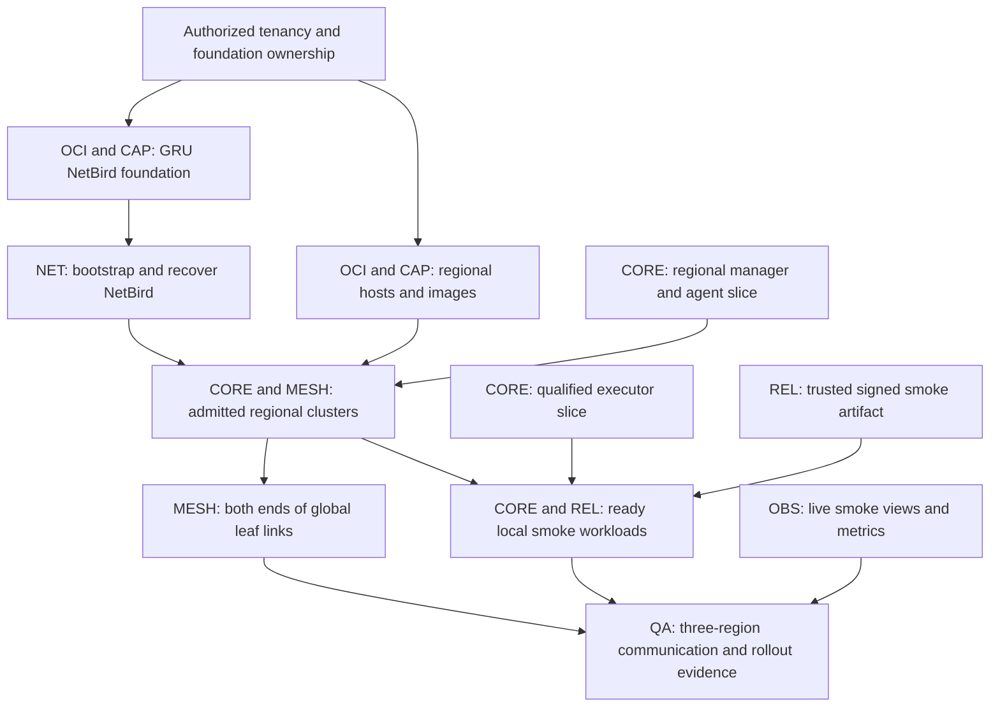

> **Mandatory model routing (user decision):** Record each task's estimated
> duration in minutes before assignment. Tasks confidently estimated below
> **10 minutes**, including tasks below 5 minutes, use **LUNA 6**
> (`gpt-6-luna`). Everything else uses **GPT 6.1 Sol, high reasoning**
> (`gpt-6.1-sol`, `reasoning_effort: high`), including tasks estimated at
> 10 minutes or longer and tasks with uncertain duration. Reassign to the latter
> if a short task's revised estimate reaches 10 minutes or becomes uncertain.
> This replaces older model-routing
> preferences for this refactor. Split tasks at real independent boundaries;
> do not split an inseparable task merely to use the cheaper model.

# Replace custom orchestration with SwarmKit: OCI, A1-first and mixed runtimes

Replace the existing custom orchestration engine with embedded upstream
SwarmKit. Delete the superseded scheduler, task reconciliation, native workload
supervision and generic rollout machinery, including their dependent code and
tooling. `ts-orch` remains the single Go binary, cluster CLI and dashboard,
owning OCI/NetBird integration around SwarmKit.

**Review all project code and its connected callers, configuration, workflows,
tests and dependencies to make automatic deployment across every authorized
region easier, faster and simpler, with fewer dependencies.** Remove superseded
paths as the replacement lands. This is a required outcome of the refactor.

Start all independent workstreams together. Integrate the smallest working slices
on disposable A1 Flex capacity: automatic regional formation, one containerd
executor and a healthy rolling container deployment. Develop ARM/x86, Wasm,
database safety and visibility concurrently; gate each live cutover on its own
prerequisites and retained qualification evidence.

## Status and decisions

Planning revision, 2026-10-16. Code baseline: `0e7bbf8e`; original plan: `7a65ad45`.
This document records the reviewed direction; it does not claim an implemented
runtime, measured savings, production readiness, or deployment authorization.

| Decision | Direction |
| --- | --- |
| Infrastructure owner | `ts-orch` reconciles the platform's complete OCI lifecycle through the existing Go SDK clients. |
| Capacity | Prefer `VM.Standard.A1.Flex`; qualify other ARM families and x86 without changing workload identity. |
| Orchestration engine | Embedded upstream SwarmKit replaces the custom orchestration engine. Delete the superseded implementation and its dependents; no permanent legacy scheduler or fallback execution path. |
| First-party workloads | OCI containers through containerd and runc; no Docker Engine. |
| Customer workloads | Short-lived Wasm functions on isolated worker hosts. |
| Mixed execution | Native `linux/arm64`, native `linux/amd64`, and portable Wasm coexist in each region as demand requires. |
| Security and joining | Substantially simplify custom protocols; automatic discovery and worker admission using OCI identity and Vault-delivered bootstrap material. |
| Automatic regional deployment | Continuously reconcile the authorized regional footprint, provision missing foundations/hosts, form each regional cluster and join the global fabric without per-region commands, manual enrollment or activation flags. |
| First regional milestone | A small, working GRU / San Francisco Bay Area / FRA deployment, communicating through orchestrator-managed NetBird. |
| NetBird control plane | One dedicated A1 Flex VM in GRU, owned and recovered by `ts-orch`. |
| Human and AI interface | `ts-orch` is the complete cluster CLI for operators and AI agents; CLI and dashboard share authenticated cluster APIs and operation semantics. |
| Operational dependencies | No KU service, CLI, API, credential, task state or reporting requirement. Cluster operation and release admission use orchestrator state and retained evidence. |
| Dashboard and visibility | Extend the existing Go `templ` + Datastar + Apache ECharts dashboard, embedded in the binary, with one stylesheet and complete metric discovery, history and cluster drilldowns. |
| Build and deployment boundary | GitHub-hosted Actions is the current build producer. Deployment consumes signed, digest-addressed artifacts through the orchestrator and object storage; it requires no particular source repository or live CI API. No Forgejo server, runner, token, CLI, or package-fetch requirement. |
| Testing | Delete all unit tests and unit-only infrastructure. The final repository and CI use integration testing only; migrate required safety and failure coverage into real boundary-crossing scenarios before removing its old tests. |

Wasmtime is the proposed first function runtime, subject to the compatibility
prototype below. The user selected customer Wasm, not a particular WASI version
or runtime implementation. Do not present Wasmtime or WASI Components as an
already qualified dependency. Use wazero instead if the actual function contract
fits its supported interfaces and its simpler Go integration wins the comparison.

OCI-native means OCI Compute, networking, storage, IAM, Vault, and registry APIs
are the infrastructure primitives, with `ts-orch` owning their reconciliation.
It does not require OKE, Kubernetes, Docker Engine, or a second infrastructure
controller. Keep embedded regional NATS for orchestrator communication.

This decision scopes the orchestrator-managed platform; it does not move other
TerraScale services off Fly or Cloudflare. Keep the existing external service
hosting boundaries. No new paid capacity, IAM permission, credential, or secret
installation is authorized by this planning document.

## Parallel execution plan (user decision)

**Every section below belongs to a parallel workstream. Document order and
numbered acceptance checks do not impose implementation order.** Start discovery,
contract design, implementation, test-only fixtures and baseline collection in
every stream immediately. Block only the work item that consumes an unavailable
contract, resource or safety proof. A blocked live exercise does not block its
stream's remaining implementation work or another region's independent work.

### Startup checks: parallel tasks with local blockers

Start these five tasks together, following the model-routing rule at the top.
Record actual owner names, ETA/model, claimed files, outputs and evidence in the
existing work ledger. A pending check blocks only the action named in its last
column. It does not create a repository-wide approval or design freeze.

| Task / accountable owner | Concrete check and output | What waits for this result |
| --- | --- | --- |
| **START-OWN — assignments and integration** / QA + every stream | Name the shared-file/main integrator and each initial implementer. Give every first task an exact file claim, independently complete output, integration scenario, ETA/model and isolated worktree. Resolve overlapping claims before editing those files. | Only edits to unclaimed/conflicting files and publication without an assigned integrator; independent claimed work starts immediately. |
| **START-EXEC — disposable runtime prototype** / CORE + CAP | Pin SwarmKit/containerd/runc versions. On disposable authorized capacity, prove one real container can prepare/start, report readiness, stop/remove and recover its task identity after agent restart without launching a duplicate. Publish the narrow executor/image contract and observed limitations. | Production use and consumers freezing unproven executor semantics. Other streams develop against agreed boundaries, while CORE/CAP build and run the prototype together. |
| **START-DEPLOY — current main-to-production path** / REL + QA | Inspect actual main CI triggers, deployment targets, production-environment protection, credential scopes and artifact promotion. Record how each incomplete slice is qualified on disposable targets and how only qualified runtime revisions reach production. Existing main pushes can auto-dispatch fleet deployment; workflow names alone are not protection evidence. Preserve always-on operation without kill switches, disabled checks or a legacy-engine selector. | The first runtime-affecting main publication that could reach an unqualified production target. Documentation, isolated implementation and integration-scenario preparation proceed concurrently. |
| **START-SCOPE — cloud footprint and budget** / OCI + CAP | Record approved tenancy/compartments, GRU/SFO/FRA footprint, numerical spending envelope, four-VM sizes, storage/transfer costs and cleanup ownership. Identify existing IAM/Vault authority and any separately required permission/credential approvals. Pending authority remains explicit; do not assume capacity is free or create credentials to complete the check. | Paid provisioning and mutations outside existing authority. Source work, inventory of authorized non-secret metadata and scenario design proceed independently. |
| **START-STORE — storage comparison** / QA + CAP | Assign an independent OCI Object Storage versus Tigris cost/reliability comparison using actual copies, placement, requests, transfer, backup and restore traffic. Report price sources, workload assumptions and unknowns. A globally reachable endpoint does not establish regional durability. | A storage-backend change or a claim that one provider is cheaper. Existing OCI adapter work and the initial milestone continue without waiting for this research. |

Each stream also begins its own integration-test migration from the start. QA
coordinates shared test infrastructure and CI changes; no single test-conversion
task must finish before unrelated streams implement or qualify their boundaries.
Production publication still requires START-DEPLOY and the applicable runtime,
trust and safety gates; a short ETA never relaxes those requirements.

### Workstreams: foundations, runtime and releases

Each stream has one accountable owner. Paths identify responsibilities; shared
directories require a file-level claim before editing.

| ID / owner | Owns | Start independently | Live integration prerequisite |
| --- | --- | --- | --- |
| **OCI — infrastructure** | Foundation/resource lifecycle, durable regional operations, SDK coverage, identity/Vault delivery; `internal/ociclient`, `internal/ociregion`, `internal/ociresource`, `internal/region`. | Map owned resources and call graph; implement restart-safe reconciliation and replace CLI subprocess boundaries. | Scoped tenancy/spend authority for mutations; qualified image from CAP for host launch. NET consumes only its GRU foundation slice. |
| **NET — NetBird** | Dedicated GRU service, setup-key recovery, account policy, backup/restore; `internal/netbird` and its foundation integration. | Remove ts-ops/manual-PAT assumptions; implement fenced writes, upstream component lifecycle and recoverable enrollment. | OCI's GRU VM/network/Vault endpoints for bootstrap; no dependency on regional SwarmKit or its own overlay. |
| **CORE — SwarmKit/runtime** | Regional manager/agent formation, containerd executor, service/task mapping, routing readiness and old-engine replacement. | Pin upstream contracts; implement executor and stateless lifecycle against test-only providers on ARM/x86. Inventory old scheduler/runner callers now. | CAP's qualified runtime image, REL's admitted artifact and OCI/NET's reachable admitted host for fleet execution. Local disposable qualification can proceed earlier. |
| **CAP — capacity/images** | Shape/architecture/runtime/image/price contract, pool identities, managed host dependencies; `internal/nodescale`, `internal/image`, `internal/ocicost` and named OCI image/seed files. | Remove A1-only assumptions coherently; build architecture-specific image inputs and compare compatible shapes. | Authorized provider access/capacity for live measurements; CORE's executor compatibility for final runtime qualification. |
| **REL — release trust/delivery** | Producer/apply separation, signer sequence, artifacts/channels, event hints and release CI; `internal/release*`, `internal/delivery`, relevant workflow/scripts. | Fix regional preflight isolation; remove source/CI dependencies from apply and design signed sequence migration. | Trusted publisher/Vault/object endpoints for publication; CORE is needed only to prove running workload rollout. |

### Workstreams: federation, product surface and qualification

| ID / owner | Owns | Start independently | Live integration prerequisite |
| --- | --- | --- | --- |
| **MESH — regional/global messaging** | Embedded NATS formation, durable membership, scoped global leaf admission, Atlas publication and topology; `internal/natscell` and named membership/global-control integration files. | Define admitted membership versus observed health; implement loop-free topology and restart/partition handling. | OCI/NET host identity and connectivity for regional/global joining. Local service readiness remains independent of a global link. |
| **OBS — CLI/dashboard/telemetry** | Shared feature API views, CLI output/JSON, metric catalog, Datastar/templ/ECharts and one CSS file; `internal/dashboard`, `internal/observability`, named CLI handlers. | Build real API consumers, metric discovery/history and UI against versioned test fixtures; consolidate styles. | Each producing stream's specific observation/API for its live panel; do not wait for the whole cluster to finish. |
| **WASM — functions** | Runtime comparison, invocation/artifact contract, HTTP/queue workers, isolation, cancellation and caches. | Compare Wasmtime/wazero and implement bounded workers on both architectures with test-only host capabilities. | CORE/REL/CAP qualified workers plus tenant-scoped capabilities for live execution; DATA only for a capability that actually uses TerraBase. |
| **DATA — stateful safety** | Writer/volume fencing, catch-up, drain, backup/restore, on-disk/CPU compatibility; retained storage/database lifecycle boundaries. | Extract safety contracts and qualify restore/fencing behavior independently of scheduler cutover. | CORE executor lifecycle hooks, OCI volume ownership and qualified artifacts for live migration. Production cutover requires its own safety evidence and authorization. |
| **QA — integration/evidence** | Dependency/removal and unit-test-conversion ledgers, integration scenario tooling/CI, comparable cost/timing samples, shared-file integration and exact-candidate evidence. | Map cross-stream dependencies and baseline scenarios; inventory unit suites, prepare integration drivers and review each small handoff. | Only the producers used by each scenario. Collect partial results and qualify branches independently; the final completion gate aggregates them. |

### Contracts and file ownership

Publish the smallest consumable contract at each boundary through existing
feature packages/APIs. The producer owns its schema and semantics; consumers
review only fields they use. Agree that boundary before integrating it. Other
boundaries and streams continue while it is being settled. Reuse existing types
and versioning; no new universal workflow engine, plugin layer or contract store.
CORE and CAP jointly qualify an executor candidate on a bootable image candidate;
neither waits for the other's whole-stream completion. OCI can deliver network,
Vault and ownership records before compute launch, unblocking NET/REL work.

| Boundary / producers | Minimum handoff | Consumers |
| --- | --- | --- |
| Foundation and identity — OCI + NET | Owned resource IDs, operation/authority generation, role/region identity, reachable endpoints and scoped Vault references; never secret payloads in the work ledger. | CORE, CAP, MESH, REL, DATA. |
| Runtime and capacity — CORE + CAP | Stable task/service identity, runtime/architecture/CPU constraints, pinned image/index/child digests, lifecycle/readiness observations and safety-hook semantics. | REL, WASM, DATA, OBS. |
| Membership and release — MESH + REL | Separate authorized/admitted/observed regional facts, topology generation, signed ordering/scope and per-region apply results. | OCI, CORE, OBS, QA. |
| Stateful/invocation safety — DATA + WASM | Separate database fence/drain proofs and tenant-scoped invocation/capability contracts, including rejection and recovery semantics. | CORE, REL, OBS, QA; no shared generic execution engine. |
| Views and evidence — every producer + OBS/QA | Stable operation IDs, typed errors, stages/timestamps, metric names/units/safe labels, stale/missing state and redacted scenario results. | CLI, dashboard, qualification reports. |

1. **Claim files before editing.** Each work item records owner, exact files,
   ETA/model, contract consumed/produced, integration evidence and remaining
   blocker. Split work at feature/file boundaries. Use isolated branches/worktrees
   when several implementers share the checkout; do not concurrently commit the
   same tree.
2. **Keep shared edits short.** QA's integrator owns shared `go.mod`/`go.sum`,
   entrypoints, `internal/app` wiring files, shared workflow files and this plan
   unless ownership is explicitly handed to a stream. Streams submit focused
   integration diffs; independent package work continues during that handoff.
   Two streams touching one directory do not automatically share every file.
3. **Integrate small working slices.** Each handoff includes migrated callers,
   errors/auth checks and its removed dependents. Avoid long-lived integration
   branches, compatibility flags and production fakes. Test-only fixtures permit
   consumer development; live paths report unavailable dependencies honestly.
4. **Track local readiness.** Work items move through ready, active, blocked,
   qualified and integrated with an exact blocker/producer reference. Unblock a
   consumer when its required contract slice lands; do not wait for an entire
   stream or a repository-wide contract freeze. This ledger belongs in existing
   docs/operation evidence, not a new runtime coordination service.
5. **Publish through one main integrator.** Commit and push completed slices to
   `main` directly, per the user decision; no PR is required. Serialize only
   conflicting file updates and main publication, preserve CI/qualification and
   production authorization gates, and never force-push or bypass protections.
   Existing CI can trigger deployment on a main push; record the actual outcome.

### Minimum live dependencies for the first milestone

The diagram shows consumable slices needed for the smoke milestone. All source
work above starts concurrently. Arrows constrain only live integration; paid
resources and credential operations still require existing authorization.



NET bootstrap, regional host preparation, executor development, artifact
publication and visibility implementation overlap. After NetBird and required
regional foundations are ready, GRU/SFO/FRA joining proceeds independently;
global link reconciliation overlaps local workload admission/readiness. Wasm
prototypes, DATA safety qualification, alternative-shape work and cost research
continue throughout and do not block the A1 connectivity milestone. Full mixed
runtime, HA, visibility and production claims retain their separate gates below.

## Required replacement and deletion scope (user decision)

**Owners:** CORE leads task-engine replacement; DATA owns safety extraction;
each stream deletes its dependents, and QA closes the cross-stream ledger.
Inventory, replacement implementation and caller review run concurrently.

**SwarmKit is the selected replacement. This refactor is incomplete while the
old orchestration engine or a fallback path to it remains in the final tree.**
Qualification gates production rollout and safe deletion order; it does not
make the SwarmKit replacement optional. Adding SwarmKit beside the old engine
does not satisfy this plan.

1. **Delete the custom scheduling engine.** Replace generic workload placement,
   replica convergence, task assignment, node/task reconciliation and generic
   rolling-update/restart/rollback state machines with SwarmKit's native service,
   task, node and update mechanisms. Remove duplicate task ownership and task
   desired-state stores. Product intent and read-only observations can remain;
   they must not form another task scheduler.
2. **Delete the old workload execution path.** Replace direct native process
   launching/supervision, task dispatch over host sessions and execution leases
   used solely by that path with the SwarmKit agent and containerd executor.
   Convert first-party services to digest-pinned container tasks. SwarmKit also
   owns long-lived Wasm worker tasks; worker-local invocation handling remains.
   The adapter must implement runtime lifecycle, not reproduce a scheduler.
3. **Delete every orphaned dependent.** Follow all callers of removed code and
   remove obsolete CLI commands, API handlers, NATS subjects/consumers, task KV
   schemas, configuration, secrets/IAM grants, scripts, workflows, dependency
   entries, mocks, fixtures and old-engine-only tests. Move useful behavioral
   contracts into integration scenarios against the replacement. Delete all
   remaining unit tests under the testing policy below. Update docs and dashboard
   sources to SwarmKit observations. Do not leave parked packages, compatibility
   switches, legacy backend selectors or an alternate executable retaining the
   old engine.
4. **Keep the platform responsibilities through narrow integrations.** `ts-orch`
   owns OCI capacity/resources, regional bootstrap, NetBird, global federation,
   Vault delivery, signed artifact admission, product APIs, CLI/dashboard and
   telemetry. Autoscaling computes desired SwarmKit service replica counts and
   OCI host capacity; it does not pick task hosts. SwarmKit owns orchestration
   state in its Raft store; NATS remains regional/global messaging and queues.
5. **Port safety before deleting its old implementation.** Move TerraBase
   writer/volume fencing, catch-up, drain and restore checks into the replacement
   database lifecycle/executor boundary. Retain infrastructure/controller binary
   bootstrap and recovery outside the application tasks they start. Preserve
   authorization, release trust and data; these are required replacement
   behavior, not a reason to retain the old execution engine indefinitely.

### Concrete removal inventory

Inventory by responsibility and caller; these are starting locations, not
instructions to delete whole mixed-purpose directories blindly.

| Existing responsibility / source | Required disposition |
| --- | --- |
| `internal/workload` generic placement/convergence and `internal/app/workload_autoscale.go` wiring | Replace with service-intent/replica translation into SwarmKit; delete old placement and task-write loops. Retain only needed product policy outside task scheduling. |
| `internal/machines/schedule.go` and dependent planner/placement code | Delete the custom Machines scheduler; adapt retained product API semantics to SwarmKit services/tasks. Never wire the old planner as another backend. |
| `internal/host` native runner, execution dispatch and session-driven task lifetime | Delete the superseded process execution protocol/runner and its dependents after migrating tasks. Extract required host identity, infrastructure observation and volume safety into the owning integrations. |
| `internal/rollout`, `internal/placement` and `internal/app` orchestration callers | Remove generic task rollout/placement state and duplicate dispatch. Port application-readiness policy, database safety and retained release evidence to SwarmKit-backed paths; audit shared infrastructure/self-update callers separately. |
| Old-engine-only storage, transport, tools and dependency graph | Remove dead subjects/KV clients, config/types, endpoints, scripts, credentials, fixtures/tests and module entries once no retained caller needs them. Delete empty feature slices and misleading docs. |

### Migration completion gate

Every slice records the removed responsibility, replacement owner, migrated
callers and deleted files/dependencies. Only one engine owns a workload during
cutover. Old binaries and data may be retained for the bounded approved migration
and recovery period, but the final source and deployment have one orchestration
engine. An unhealthy replacement is a rollout stop/restore condition; do not
ship a permanent legacy fallback or a switch to choose engines.

Completion requires source/dependency inventory showing no reachable old
scheduling/execution path, SwarmKit-backed CLI/dashboard state, automatic
regional/global joining, and retained rollout/failure/recovery evidence. Preserve
historical audit records and migrate/delete persisted task state only after its
replacement and retention requirements are established. This document authorizes
the replacement direction, not an immediate destructive production cleanup.

## Review verdict and required corrections

**Parallel owners:** OCI, CAP, CORE and NET/MESH take the corresponding gaps
below immediately. Each gap gates only the integration that relies on it.

Proceed with the SwarmKit replacement and deletion plan. Preserve rollout,
isolation and database safety while closing these implementation gaps:

1. **Complete OCI ownership.** Existing resource reconcilers manage selected
   rules and backends; creating infrastructure once is not continuous lifecycle
   management. Join provisioning, repair, upgrades, backups, and safe retirement.
2. **Remove the A1-only model.** Pool recipes, regional validation, bootstrap,
   and cost estimation contain A1/ARM assumptions. An x86 container cannot run
   on an ARM host just because both hosts joined the same scheduler.
3. **Qualify the SwarmKit integration.** It adds regional Raft beside
   NATS/JetStream and needs a containerd executor, OCI capacity controller and
   routing. Keep these adapters narrow and remove the replaced control paths;
   measure overhead without rebuilding the old orchestration inside the adapter.
4. **Close bootstrap and identity gaps.** NetBird admission must lead to serving
   automatically, while OCI permissions come from verified host identity.
   Workers cannot create a new regional cluster after an empty discovery result.
5. **Make migrations explicit.** A newer ARM family, ARM-to-x86 move, database
   relocation, and Wasm recompilation have different compatibility requirements.

## Required all-region deployment simplification (user decision)

**Parallel owners:** OCI owns durable provisioning, REL owns artifact apply,
CORE owns task-engine replacement, and QA tracks removals and measured outcomes.
Each stream implements its portion alongside the others.

Use the [deployment code review](docs/deployment-simplification-review.md) as the
initial evidence and removal inventory. It traces the highest-risk deployment
paths; it is not an exhaustive inspection of every source file. Each migrated
slice must finish the review of its callers, tests, fixtures, schemas, APIs,
credentials, scripts, workflows and dependencies before declaring completion.

### Required deployment behavior

1. **One operation, independent regions.** The CLI submits authenticated intent;
   durable controllers reconcile it. Validate shared local bundle/trust invariants
   once. Resolve regional scope, admit, transfer, deploy and observe independently
   with bounded concurrency defined in code. A failed or unreachable region must
   not block healthy regions or cancel their work. Preserve per-region errors,
   operation IDs and retry progress. Keep real dependency ordering, regional
   quorum, health checks and database drain/fencing gates.
2. **Provision from authority, not serving health.** Reconcile the authorized
   footprint and authenticated foundation/admitted-membership records before
   any serving heartbeat exists. Atlas publishes routing/health observations;
   it must not be the only deployment or bootstrap discovery source. Recover
   controller ownership and in-flight operations durably; observe actual
   resources instead of treating a completed local journal entry as proof of
   current state. Recover NetBird/Vault writes without hand-written records,
   duplicate keys or blind secret rotation. GRU foundation recovery works before
   the overlay and workload scheduler are available.
3. **Build once; consume immutable releases.** Keep GitHub/source verification,
   signing, Go/Nix/image toolchains and producer-only CLIs at publication. Deploy
   already verified artifacts using `ts-orch` and OCI APIs without a source
   checkout, `gh`, CI availability or a rebuild of the deploy tool. Extend the
   existing signed-apply boundary across first-party services. Allocate one
   durable signer-owned sequence across producers; migrate signed ordering
   without resetting regional anti-rollback floors. Webhooks only wake
   reconciliation. Reuse verified bytes by digest within an operation and
   reconcile regional copies without weakening admission or storage durability.
4. **Delete dependencies through the whole call graph.** Replace operational
   OCI CLI fallback/backend switches and self-invoked CLI/stdout parsing with
   existing Go SDK clients and typed feature functions as their coverage lands.
   Follow every removed caller through imports, scripts, workflows, fixtures and
   module entries. Keep only justified runtime dependencies. SwarmKit replaces
   the old orchestration engine; no second workflow framework, scheduler,
   provisioner, task store or permanent legacy backend. Preserve required NATS
   fork behavior until upstream equivalence is qualified.
5. **Make partial success reusable.** Persist successful regional image imports,
   resource identities and stage outcomes even when another region fails.
   Resume only unfinished or drifted work after restart. Reuse the existing
   image-import fanout and host-image-input change detection; do not rebuild a
   host image for each application release. Use the actual artifact input graph
   to avoid publishing/deploying unchanged binaries for documentation-only
   changes; retain relevant checks and scheduled base-image refreshes. Qualify
   shape, image, architecture, runtime and price together so exhausted A1
   capacity can use an approved
   alternative without bypassing compatibility or spend authority.

### Evidence required before claiming simpler or faster

| Measure / scenario | Required evidence |
| --- | --- |
| Operator effort and dependencies | Before/after inventory of commands, manual inputs, credential handoffs, external executables and services required for cold bootstrap, routine release and recovery. Production targets: no per-region setup commands, no manually copied first-party secrets, no source/CI dependency at apply time and no operational Python OCI CLI. |
| Deployment time and repeated work | Retain stage timings for cold region creation, warm release and interrupted retry. Report sample count, p50/p95/p99 when meaningful, slowest region and fleet completion; break out API waits, network join, artifact transfer, image pull and readiness. Record repeated builds, inspections, hashes and bytes transferred. Set numeric targets from a measured baseline; publish no assumed speedup. |
| Regional independence | In GRU / San Jose (`sfo`) / FRA, make one region's scope/status/storage unreachable or stale. Healthy regions still deploy safely; the failed region reports its blocked stage and catches up after recovery. A live Atlas/CI API is not required to apply an already admitted release from trusted membership. |
| Restart and partial failure | Interrupt after resource creation, Vault setup-key storage, image import and channel publication; restart or transfer ownership. Reconcile existing identities without duplicate foundations, competing founders, key replacement or lost successful-region results. Show pending global operations during a partition; do not invent global authority. |
| Trust, safety and ownership | Refuse wrong scope/architecture, tampered bytes, expired admission and stale release order. Prove producer changes retain the signed sequence floor, and SwarmKit is the only task owner. Retain quorum, database writer/volume fencing and restore evidence. CLI/dashboard expose real progress, timings, partial errors and stale/missing metrics through the shared API. |

Port these contracts to the SwarmKit implementation. Avoid expanding the old
scheduler merely to satisfy them temporarily. Record exact removed dependencies
and files per slice; do not promise line-count, cost or latency savings without
measuring them. These are implementation acceptance requirements, not tests or
live deployment results produced by this planning change.

## Simpler deployment contract (user decision)

**Owner: REL.** Start producer separation, independent regional apply, signed
sequence design and artifact inventories concurrently. QA/CAP compare storage
costs in parallel; the comparison blocks only a backend change, not existing
admitted-artifact deployment. Preserve the selected store's required semantics.

Source hosting and CI are build inputs, not runtime deployment dependencies.
A release must remain deployable while its source repository or CI API is
unavailable. Do not solve missing historical repository pins by requiring those
repositories to be recreated or by coupling rollout to a replacement monorepo.

1. **Publish signed artifacts.** A trusted publisher produces immutable bytes
   addressed by digest and signed release metadata binding service, source,
   runtime/architecture, size, environment, region, validity and ordering. Keep
   existing root delegation, compatibility, database fencing and rollback rules.
   Source/CI identity is provenance governed by trust policy, not a hostname the
   deployment consumer must contact.
2. **Apply through existing channels.** Reuse the regional release channels and
   their signature/digest admission, CAS publication, durable ordering and health
   gates. `ts-orch release apply --dir BUNDLE --root-key TRUSTED_ROOT --namespace NS`
   applies existing signed orchestrator channels and digest-named binaries. It
   requires no `gh`, Git checkout or signing key. Service publishers already have
   a generic signed-claim channel; unify the producer/apply boundary across roles.
3. **Notify without granting authority.** An artifact-published webhook or object
   event may wake reconciliation. It must not authorize a release or supply an
   arbitrary download URL. Fetch only admitted object locations and verify signed
   metadata and bytes. Duplicate/out-of-order events are harmless; periodic
   reconciliation recovers missed notifications. No new webhook listener is
   implemented by the current migration.
4. **Keep one release order.** Allocate a durable signer-owned release sequence
   across producers. Current channel ordering uses the signed historical
   `run_number` field; independent repositories' CI counters must not replace that
   shared ordering. This migration preserves the existing ordering and refuses
   stale releases; cross-producer sequence allocation remains required work.
5. **Compare storage using total cost.** Evaluate OCI Object Storage and Tigris
   for actual region placement, durable copies, transfer, request and restore
   traffic. A global endpoint is not proof of three durable regional replicas.
   Preserve the existing storage interface and postpone a new adapter until the
   cost/reliability comparison identifies a benefit.

Legacy GitHub-specific signing/discovery tools remain publisher adapters during
migration. Missing historical service repositories block those old qualification
and E2E inputs; they are not prerequisites of applying already admitted releases.
Never replace signature verification with a webhook shared secret or a successful
CI status, and never relabel historical provider evidence.

### Remove KU from the operational contract

**Owners:** Every stream removes its active KU requirements in its own files;
QA inventories residual references and preserves historical evidence.

KU is not a prerequisite for building, testing, qualifying, provisioning,
joining, deploying, observing or recovering the cluster. Do not query a KU task
or require a KU comment/status to authorize or complete an operation. Record
operation results through `ts-orch`, signed release evidence and the repository's
runbooks/evidence; GitHub issues/PRs may reference them without becoming runtime
dependencies. Preserve the actual safety, authorization and health gates.

The repository inventory found KU references in documentation, not a Go module,
runtime, build or CI integration. Remove active KU links/reporting instructions.
Historical evidence and exact external host/bridge names remain audit facts and
network exclusions, not services to deploy or resources to adopt. No KU server,
network or unrelated workload is changed or deleted by this cleanup.

## One cluster CLI and complete dashboard visibility (user decision)

**Owner: OBS; every stream owns its feature observations and commands.** Split
metric catalog/history, CLI views, charts and CSS into disjoint files/work items.
Start against agreed test-only fixtures, integrate each real provider as it
lands, and qualify CLI/dashboard parity per feature. Full visibility is an
aggregate acceptance gate, not a prerequisite to implementing another panel.

`ts-orch` is the operational interface for the user and AI agents to inspect and
manage the whole authorized cluster. Cover discovery, OCI resources/capacity,
NetBird, workloads, releases, credentials, backups/recovery, health, metrics,
logs, events and costs. Ordinary cluster operations must be available through
the binary rather than requiring scripts, provider dashboards or direct SSH.
Provider clients and supervised host tools remain implementation dependencies;
initial tenancy authorization retains its prerequisite and approval boundaries.

1. **Share one control contract.** CLI and dashboard call the same authorized
   feature services/APIs. Provide readable CLI output plus stable, versioned JSON
   for AI/automation, meaningful exit codes and resumable operation IDs. Mutations
   retain plan/diff, identity, fencing, audit and destructive-action safeguards.
   Read-only visibility never implicitly grants write access.
2. **Reuse the implemented UI stack.** Here "tmpl" means the existing Go `templ`
   components in `internal/dashboard`, with Datastar streaming updates and
   vendored Apache ECharts. Embed assets in the single Go binary. Consolidate
   styles into `internal/dashboard/assets/dashboard.css`; remove the separate
   Pico stylesheet while preserving required base styles and license notices.
   No additional CSS files, CSS imports, per-page styles or second frontend stack.
3. **Make every metric discoverable.** Maintain a searchable metric catalog with
   descriptions, units, types, safe labels, source, collection time and available
   history. Every collected/exported metric family must be reachable through
   both dashboard and CLI. Add missing instrumentation across the managed
   lifecycle; show unsupported, missing, stale and truncated observations
   explicitly. A green overview with missing regions is not full visibility.
4. **Make charts explain the cluster.** Provide a global overview and regional,
   host, workload and resource drilldowns, correlated metrics/logs/events and
   operation timelines. Use consistent colors, readable axes/units, synchronized
   time windows, tooltips, zoom and useful legends. Show topology and link
   latency/loss, utilization, capacity, costs, deployment history and recovery
   status. Support keyboard access, reduced motion and table/text alternatives.
5. **Prove coverage on the three-region milestone.** Inspect the same observed
   resources, metrics and operation IDs through CLI and dashboard across GRU,
   San Jose and FRA. Demonstrate live updates and historical drilldowns, then
   interrupt one region and a telemetry stream: healthy regions remain visible,
   gaps stay visible, and reconnect restores a consistent view. Add ARM/x86/Wasm
   runtime coverage as each runtime is qualified. Retain evidence before claiming
   complete visibility.

Use bounded collection, label cardinality, history tiers and streaming queues so
observability remains viable on small A1 hosts. Retention and dropped samples
must be visible; complete metric coverage does not imply infinite raw history.
Keep secrets and customer payloads out of telemetry, CLI output and chart labels.
See [the CLI and dashboard contract](docs/cluster-visibility.md) for coverage and
implementation gaps. This section defines desired state, not completed features.

## First desired state: three regions that actually communicate

**Owner: QA; producers: OCI, NET, CORE, CAP, REL, MESH and OBS.** Prepare regional
inventories, probes and evidence collection concurrently. Launch each region's
ready foundation/join workload without waiting for unrelated work in another.
All three regions must pass before claiming the complete milestone.

| Display location | OCI region | Existing product token |
| --- | --- | --- |
| GRU / São Paulo | `sa-saopaulo-1` | `gru` |
| San Francisco Bay Area (OCI San Jose) | `us-sanjose-1` | `sfo` |
| FRA / Frankfurt | `eu-frankfurt-1` | `fra` |

Keep the existing `sfo` product token; OCI's region key is `SJC`. Fly's `sjc`
identifier is a different provider's naming convention. Do not substitute
Phoenix or rename stored identities to make the display name match.

Start with four disposable A1 VMs: one regional controller per region and one
dedicated GRU NetBird server. Each regional controller runs its own embedded
NATS and a bounded, trusted smoke workload. This is a connectivity milestone,
not a highly available deployment or a customer execution environment. The
qualification topology belongs in test tooling, never a production singleton
switch. Before HA claims, qualify three managers per region: ten VMs including
NetBird, plus any isolated workload/function hosts required by later slices.

Acceptance requires real OCI hosts and the exact qualified source/artifacts:

1. **Automatic formation.** All three controllers infer their regions, join
   NetBird, discover the other regions, and expose authenticated readiness with
   observed commit/digests. Restart one without manual enrollment or enable flags.
2. **Working communication.** Exercise authenticated request/reply in all six
   directed regional pairs and verify replies identify the intended region.
   Use a loop-free NATS leaf tree rooted in GRU; a request may traverse GRU.
   Prove required overlay paths and DNS; a ping or peer count alone is not enough.
3. **Working rollout.** Deploy the trusted smoke workload in every region, serve
   requests for 30 minutes, update it by digest, and recover an unhealthy release.
   Record failures and recovery time; an unavailable region cannot count as passed.
4. **Failure and recovery.** Restart the central server, test a relay-dependent
   peer, and restore NetBird from an off-host backup onto a replacement GRU VM.
   Existing direct tunnels may survive; new joins and relayed paths may not.
   Separately interrupt the GRU NATS hub and prove other regions keep serving
   locally while unavailable cross-region operations are reported honestly.
5. **Publish evidence.** Retain redacted inventories/OCIDs, peer and link health,
   six-direction results, boot/join/rollout/recovery timings, resource use, and
   the actual regional bill under `benchmark/bench/`. Include CLI/dashboard
   parity, metric coverage and missing-region/stream-recovery evidence from the
   visibility contract above. Add separate ARM/x86/Wasm
   workload hosts before claiming the mixed-runtime milestone is complete.

These are desired acceptance results, not a report that the fleet exists.
Provisioning and destructive recovery exercises retain their authorization gates.
Run independent read-only probes and per-region checks concurrently. Serialize
restarts/restores that affect the same manager, quorum, volume or measured
scenario; give destructive exercises isolated fixtures or an explicit resource
reservation. A failed probe records its result without discarding other regions'
evidence. Rerun affected checks after recovery on the exact integrated candidate.

## NetBird: a managed GRU foundation service

**Owner: NET.** Component packaging, API lifecycle, enrollment recovery,
account-policy fencing and backup/restore tooling can progress concurrently in
separate files. Live bootstrap waits only for OCI's GRU foundation slice, and
regional admission waits only for the required manager/route/policy slice.
Serialize account-wide mutations under the existing GRU authority.

Provision one dedicated `VM.Standard.A1.Flex` host in `sa-saopaulo-1` for the
pinned ARM64 NetBird management, signal, relay/STUN, and required identity/TLS
components. Preserve `netbird.terrascale.tech` and existing account/peer identity
where recoverable. Inspect current resources and backups before choosing
restoration or fresh bootstrap; the historical ts-ops bundle is not live evidence.

`ts-orch` owns the VM/image, network/firewall, persistent data, DNS/certificates,
upstream component installation, health/restart, updates, setup keys, scoped API
credential rotation, groups/policies, peer cleanup, backups, and restore. Use
upstream NetBird components managed by the Go executable; do not reimplement
the VPN server or require a second operator deployment tool. The target has no
Forgejo cohosting, `ts-ops` hostname guard, pinned ts-ops private address, manual
PAT file, or dashboard-only setup step. Preserve the existing mesh address plan.

Bootstrap/recovery must work before NetBird and regional scheduler admission.
Use a narrowly authorized foundation path on OCI networking, the host supervisor,
and instance-principal Vault access. Create the initial owner/service identity
over a private local bootstrap channel, deliver its credentials into Vault
without stdout/file handoffs, and close initial setup before public exposure.
Do not schedule the sole manager through the network that it must create.
This bootstrap authority does not grant serving admission or customer privileges.

Every private regional subnet needs a verified path to the manager, DNS, OCI
identity/Vault, and artifact endpoints before enrollment. Declare and test the
chosen egress/private routing; a public hostname alone supplies no route.
Restrict public exposure to the pinned upstream version's required TLS and
STUN/relay ports, with the appropriate DNS-only endpoint for UDP. Derive least-
privilege policies from the required traffic graph, preserving scoped NATS mTLS.
NetBird's central coordination server does not imply that all peer traffic
passes through GRU. Do not create cyclic NATS links to obtain pairwise reachability.

Use one GRU authority for account-wide writes; other regions report inventory
and request scoped changes. Check authority before each write and cancel a
cycle on leadership loss. Recover partially applied operations before retrying.
Back up a consistent store together with the required encryption/identity
material to protected OCI Object Storage outside the VM; copy recovery material
outside GRU for regional disaster recovery. Prove restore preserves peer identity
and access policy. Measure and publish recovery time and recoverable data age.

The single GRU server is an accepted initial failure domain. Its loss can stop
joins, policy changes, authentication, and relay-dependent traffic. A GRU-wide
outage needs separately approved alternate-region recovery; a backup alone does
not supply that capacity. Local regional serving must not require a live manager.

## What the current code establishes

**Owners:** Each stream reviews the evidence in its slice immediately; QA tracks
cross-stream callers, stale claims and unresolved assumptions. Inventory work
overlaps replacement implementation and never authorizes premature deletion.

| Evidence | Implication |
| --- | --- |
| `internal/app/workload_autoscale.go` starts `workload.Reconciler`. | An established native-workload control path already exists. |
| `internal/machines/schedule.go` has a pure planner, with no production caller found. | The generic Machines API is not an end-to-end execution implementation. |
| The generic schema accepts rolling updates, dependencies, and stateful policy, but that planner does not enforce them. | Do not wire it into production as though those policies work. |
| `internal/placement/controller.go` verifies serving reports; `internal/app/artifact_store.go` collects artifacts. | Older README/architecture statements that these are absent are stale. |
| `internal/host/agent.go` stops execution after host-session loss. | Availability and database fencing must be separated deliberately during migration. |
| `internal/ociclient/factory.go` provides shared SDK clients and instance principals; `internal/ociregion/foundation/` creates regional foundations. | Extend these paths rather than adding a parallel cloud provisioner. |
| `internal/ociresource/` and `docs/oci-reconcile.md` cover selected rules, backend sets, and bucket protection. | Full creation, repair, and retirement still need an explicit owner for each resource. |
| `internal/nodescale/pool.go` fixes one pool and `VM.Standard.A1.Flex`; `internal/ociregion/plan.go` rejects other shapes. | Mixed roles, shapes, and architectures require changing the provisioning model, not just scheduler labels. |
| `internal/ociregion/seed.go` requires `linux-arm64`; `internal/ocicost/node.go` prices A1 SKUs. | Bootstrap images and pricing must become architecture- and shape-aware together. |

Existing `enabled`, telemetry, report/enforce, and per-region activation paths are
legacy inventory, not the target API. Remove their switches as their slices
migrate; every feature and every admitted region serves automatically. Discover
NetBird members, region inventory, placement, and qualified releases without
operator-maintained host lists or shape-selection knobs.

The original plan identified historical [#352: deployment lag exceeds 30 minutes](https://git.mariogk.com/TerraScale-Old/ts-orchestrator/issues/352).
It reports unavailable serving-region discovery and qualified-main history.
SwarmKit cannot repair missing build retention, region inventory, or deployment
evidence by itself. Inspect those paths independently.

Historical [#27: WASI tenant compute](https://git.mariogk.com/TerraScale-Old/ts-orchestrator/issues/27)
and its child issues contain useful HTTP/queue, credential-hiding, and isolation
requirements. They are closed with unchecked acceptance criteria; no first-party
Wasm runtime was found in the reviewed Go tree. Reconcile their historical C#
and runtime assumptions rather than treating closure as delivery evidence.

## Ownership: one scheduler and one task authority

**Owner: CORE.** Split manager/agent lifecycle, containerd executor and service
intent/routing into file-owned work items around upstream types. DATA defines
safety hooks alongside executor development; WASM defines worker requirements
alongside service mapping. Integrate each boundary without waiting for either
workload's complete production migration.

```text
CI -> immutable images/components -> regional deployment admission
                                      |
                              ts-orch platform controller
                              /                        \
                  embedded SwarmKit              OCI provisioning
                  regional Raft state            and database lifecycle
                           |
                  custom containerd executor
                   /                     \
         TerraScale containers      Wasm worker containers
                                           |
                                  bounded function invocations

NATS: regional events, queues, and observations; not a second task scheduler.
```

SwarmKit owns regional nodes, generic service replicas, task assignment, task
reconciliation, and rollout progression. Keep its Raft quorum inside one region;
do not form one latency-sensitive quorum across regions. The initial production
design uses three managers per region; measure its real capacity cost.

Place managers across availability domains where offered, otherwise across
fault domains. Managers may use different qualified CPU architectures; replace
one at a time without losing quorum. Regional embedded NATS/JetStream must also
form automatically with persistent identities and recoverable storage. The same
three trusted hosts may run managers and NATS if measured resource reservations
protect both quorums; exclude customer execution from those hosts.

`ts-orch` owns app intent, artifact selection, regional deployment aggregation,
OCI capacity, traffic readiness, and TerraBase's database-specific lifecycle.
It translates accepted app intent into SwarmKit services with stable identities
and retry-safe updates. `ts-orch` decides desired replica counts and required
host capacity; SwarmKit assigns generic tasks to admitted hosts. OCI instance
pools realize those host counts; do not attach an independent OCI autoscaler
that competes with this decision. NATS carries events and queues; existing
JetStream state is retained where a remaining platform feature needs it. Avoid storing two
authoritative copies of generic task placement or adding a third state store.

Containerd is a runtime, not a SwarmKit executor. Implement the adapter using
SwarmKit's `exec.Executor`, task `Controller`, and generic runtime payload.
It must prepare, start, observe, wait, drain, terminate, and remove tasks, recover
after agent restart, and expose bounded logs and resource usage. Identify tasks
by their durable SwarmKit identity so retries never launch duplicate containers.

SwarmKit does not supply containerd networking or the product's public routing.
Start with the existing private network and explicit host-port reservations;
keep containerd's socket local and privileged. Qualify port conflicts, private
service discovery, and readiness-based gateway registration. Do not add a new
overlay, service mesh, or network allocator unless this path demonstrably needs it.

The control executable remains one Go binary. Host images also contain managed,
pinned containerd/runc dependencies, and the proposed function runtime is a
container artifact. This is one control binary, not one executable for the whole
host. Reuse feature-sliced packages rather than introducing generic frameworks.

`ts-orch` installs, verifies, supervises, and upgrades these host dependencies
through its managed image/release path. Publish one controller binary per Linux
architecture from the same source revision; do not require per-host operator
installation of containerd, runc, NetBird, or a function runtime.

## OCI resources: one complete lifecycle owner

**Owner: OCI; contributors: NET, CAP, REL and DATA for their resource contracts.**
Split foundation/identity, network, compute and durable-resource work by exact
files and owned objects. Regions and independent resource groups reconcile in
parallel once their prerequisites exist. Only conflicting object writes and
tenancy-wide IAM changes serialize; one lagging group cannot gate all resources.

Reuse `internal/ociclient`, `internal/ociregion`, `internal/ociresource`,
`internal/nodescale`, `internal/oci`, and the existing storage/release slices.
`ts-orch` owns only platform resources within the authorized tenancy footprint,
not unrelated workloads in the tenancy. Its ownership inventory must cover:

| Resource group | Controller responsibility |
| --- | --- |
| Foundation and identity | Compartments, ownership tags, dynamic groups, scoped IAM policies, Vault keys/secrets, and regional discovery records. Serialize tenancy-wide IAM writes through one authority in the home region. |
| Network and ingress | VCNs, subnets, NSGs, routes, required gateways, private discovery, and the chosen OCI LB/NLB with readiness-based backends and certificate renewal. Use existing NetBird membership across regions. |
| Compute and runtime | Architecture-specific host images, instance configurations/pools, domain placement, capacity acquisition, dependency updates, draining, replacement, and orphan cleanup. |
| Durable data and artifacts | Block/boot volumes, attachment/fencing, Object Storage backups and restore verification, OCIR container images and retention, and digest-addressed Wasm artifacts. OCI API permissions use instance principals where supported; automate any registry-specific credentials through Vault. |
| Operations | Capacity/quota observations, actual usage and cost, runtime health, logs/metrics, OCI work-request failures, secret rotation, and recovery evidence exposed through the existing dashboard/insights. |

Use the required services, not every OCI product: for example, choose the
balancer the traffic contract needs rather than deploying both by default.
Cloudflare DNS/certificates and vendor-issued credentials retain their existing
provider boundary; orchestrate needed records/renewal with the established path,
and keep vendor keys once in OCI Vault. No separate Terraform/OKE control loop.

Observe live resources, compute a desired diff, persist an operation identity,
apply with OCI retry tokens/ETags where supported, and wait for the observed
result before dependent operations. Reconcile after process/leader loss without
duplicating instances, secrets, pools, or volume attachments. Check authority
before writes; after failover, recover in-flight OCI operations before starting
conflicting work. A regional outage must not stop healthy regions from serving.

Names/tags locate candidates; verify recorded OCIDs, compartment, and ownership
before adoption or mutation. Never infer permission from a mutable worker tag.
Retain data volumes, backups, and encryption material through host replacement;
retirement needs proven drain and retention safety. A discovery miss never means
delete a region or its data. Do not automatically add or remove serving regions
or buy capacity outside the approved footprint merely because it appears in OCI.

The first tenancy authorization is a real prerequisite: an unprivileged binary
cannot grant itself IAM access. Once that scoped foundation authority exists,
`ts-orch` creates and delivers first-party credentials and configures services
automatically; vendor keys are supplied once. No per-node enrollment, copied
secrets, per-region enable flag, or ongoing manual infrastructure recipe.

## A1-first capacity without an A1-only architecture

**Owner: CAP.** Shape discovery/pricing, per-architecture image production and
pool migration can develop concurrently against one small capacity contract.
Qualify families/architectures independently; A1 readiness does not wait for
all alternatives. A new candidate enters use only after its own image, runtime,
price and safety checks pass, within the authorized cost envelope.

Oracle's Compute Shapes reference checked on 2026-10-16 lists A1, A2, and A4
Flex. It does not list `VM.Standard.A3.Flex`; do not invent that identifier or
assume a numeric upgrade sequence. Treat any later family, including a possible
A3, as a discovered candidate requiring the same image/runtime qualification.

| Candidate | Architecture | Selection rule |
| --- | --- | --- |
| `VM.Standard.A1.Flex` | `linux/arm64` | Default for compatible workloads because cost efficiency is the initial goal. |
| `VM.Standard.A2.Flex`, `VM.Standard.A4.Flex` | `linux/arm64` | Use when available and qualified, and measured performance/capacity or price justifies replacing A1. |
| Available, qualified AMD/Intel Flex shapes | `linux/amd64` | Use for x86-only artifacts or a measured workload advantage; coexist with ARM capacity. |
| Other discovered families | Verify from OCI and the running host | Admit after qualification; family names alone establish neither architecture nor compatibility. |

Discover subscribed regions, domains, image-compatible shapes (`ListShapes` with
the image OCID), service limits, remaining quota, and capacity reports. A shape
listing is not spare capacity; a capacity report is not a reservation. Handle
allocation failure, refresh observations, and try the next qualified candidate
within the authorized cost envelope. Unknown price is not zero. If none fits,
leave demand pending with a concrete reason and preserve healthy capacity.

Use a fixed selection policy in code: satisfy runtime/architecture, isolation,
memory/CPU, storage/network, and failure-domain requirements first; prefer A1
among viable candidates until measured evidence justifies another family. Avoid
shape churn with a fixed stabilization policy. No operator shape lists, ordered
fallback configuration, CPU emulation, or manual per-node architecture flags.

Track OCI billing OCPUs separately from guest schedulable CPU and measured
throughput. Oracle currently documents A1 as one core/vCPU per OCPU, A2/A4 as
two cores/vCPUs per OCPU, and x86 as two vCPUs per OCPU. These do not promise
equal useful work. Measure actual CPU topology/cgroup capacity and reserve CPU,
memory, disk, and bandwidth for the OS, controller, NATS, and runtime.

Keep separate pool/configuration identities for isolation role, architecture,
and selected shape where required. Allow old and new pools to coexist during
replacement. Updating a pool's instance configuration does not itself migrate
existing instances. Include shape/image identity in recipe digests and scope
configuration pruning to the owning pool so migration cannot delete another
pool's active recipe. Trusted service, manager, and function hosts have distinct
identity and isolation requirements even when they use the same shape.

Price each candidate using its actual CPU/memory SKUs, storage/performance,
network, registry/artifact storage, backup, and required spare capacity. Compare
cost per useful workload at equal availability. Do not extend A1-only SKU logic
to another family or treat Always Free capacity as a production availability
guarantee. Three managers in every region plus isolated function hosts may cost
more than A1 worker savings; publish the whole regional bill.

## Mixed workloads and safe architecture migration

**Owners:** CAP owns host/image compatibility, CORE owns container execution,
WASM owns function portability, and DATA owns stateful compatibility/fencing.
Build and qualify each architecture/runtime combination independently. Admit
each qualified workload through the always-on reconciliation path; no runtime
feature flags. Mixed-runtime completion requires all requested combinations,
without delaying earlier safe A1/stateless progress.

An execution kind and a CPU architecture are different fields. Wasm is an
artifact/runtime contract; its worker still runs native ARM or x86 code.

| Artifact | Eligible host |
| --- | --- |
| Native ARM binary or ARM-only container | Qualified `linux/arm64` with required CPU features. |
| Native x86 binary or x86-only container | Qualified `linux/amd64` with required CPU features. |
| Multi-platform container image | Resolve its pinned index to the matching ARM/x86 child manifest; record both digests. |
| Portable Wasm module/component | Qualified worker on either architecture implementing the declared WASI/host capabilities. |
| Compiled Wasm cache/native sidecar | Exact compatible architecture, CPU features, runtime version, and compilation settings. |

Verify host architecture and capabilities through OCI inventory plus admitted
agent observations; propagate trusted constraints to SwarmKit placement. Build
controller images, containerd/runc, service images, and function workers for
both architectures. Admission refuses missing artifact variants or unsupported
capabilities before rollout. Show missing compatible capacity as pending, never
as a successful deployment or an instruction to run x86 code on ARM.

Retain portable Wasm bytes as the authoritative artifact. Compile on the target
worker and key caches by module digest, runtime/version, CPU target/features,
and relevant compilation settings. An A1-optimized cache may be invalid on a
different ARM family, even though both report `arm64`. Keep portable native
baselines or explicit CPU-feature requirements; avoid accidental `-march=native`
artifacts that only run on their build host.

For A1-to-other-ARM or ARM-to-x86 moves, acquire and admit replacement capacity,
pre-pull the matching artifacts, gate traffic on readiness, drain old tasks, and
retire old instances only after their replacements serve. Keep rollback capacity
until the release succeeds. Compatible OCI shape resizing can reboot a host;
treat it as a planned drain operation, not a live CPU upgrade. ARM-to-x86 always
requires an architecture-matching boot image and replacement host.

TerraBase and JetStream data movement require explicit storage/on-disk format
compatibility in addition to binary compatibility. Keep database membership,
replication catch-up, writer fencing, and volume ownership authoritative. OCI
block volumes are availability-domain scoped; cross-domain/region moves need
replication or backup/restore to a new volume, not an assumed reattachment.
Preserve object data and workload identity across CPU changes. Stop new writes
and complete a final catch-up/fence before transferring a database writer; a
generic readiness-based stateless replacement is insufficient. If cross-CPU
database compatibility is unproven, retain its current architecture until a
same-commit restore/replication exercise proves the migration.

## Automatic region deployment, regional joining and global joining

**Owners:** OCI + NET deliver foundation/admission, CORE + MESH form clusters,
REL supplies artifacts and OBS exposes progress. The stages below are a
dependency graph per region/host, not a fleet-wide sequential workflow.

After initial tenancy authorization, `ts-orch` continuously reconciles the
approved regional footprint. A missing authorized region is a provisioning
task, not an instruction for the operator to run `region create`. Start with
GRU, San Jose and FRA. No per-region enable step, copied plan, peer list, setup
key or manual global-registration action. Discovery of an OCI region or an
arbitrary NetBird peer does not authorize new spending or a new region.

| Stage / owner | Required input | Work that overlaps / completion evidence |
| --- | --- | --- |
| Regional foundation — OCI + CAP | Authorized footprint and fenced resource ownership. | Reconcile per-region networking, scoped IAM/Vault, buckets, qualified images/hosts and bootstrap routes independently; serialize only actual resource dependencies and home IAM writes. Recover interrupted operations and adopt only verified owned resources. NET's GRU foundation can finish before other foundations. |
| Host/network admission — NET + OCI | That host's foundation, verified OCI role/region/pool/architecture and reachable NetBird/Vault endpoints. | Enroll ready hosts while others provision; generate scoped groups/DNS/policies and deliver only role-appropriate material. No per-host operator approval after authorized identity checks pass. |
| Regional formation — CORE + MESH | Admitted host and durable regional founder identity. | Select exactly one fenced founder, publish its verified endpoint, then join embedded NATS/JetStream and role-correct SwarmKit managers/workers. Independent regions proceed concurrently. Persist/recover identities and upstream certificate rotation; empty discovery never permits a competing founder or worker self-promotion. |
| Global leaf admission — MESH + NET | Admitted identities and endpoints for both affected regions plus authorized global control generation. | Generate topology, imports/exports, peer credentials and matching policies at both ends. Different links can prepare concurrently; serialize conflicting global topology commits. Use the loop-free GRU tree and authenticate request/reply before reporting connectivity. Regional quorums remain local. |
| Local workload/readiness — CORE + REL + OCI | Qualified regional executor/capacity, admitted artifact and required service credentials; DATA proofs for stateful tasks. | Deploy local services and reconcile ingress while global leaf admission proceeds. Health/fencing gates actual traffic and Atlas readiness. A service with a genuine cross-region dependency waits only for that dependency. Publish regional readiness and global connectivity separately through OBS. |

Use bounded per-provider/per-region concurrency and backoff fixed in code;
do not start one unbounded goroutine per resource. Scope retries, deadlines and
errors to the affected operation. Cache immutable verified artifacts where safe,
reuse partial results and schedule downstream work as soon as its inputs are
observed ready. Reconciliation continuously repairs replacements, releases and
rejoining; it never waits for a fleet-wide all-stages barrier.

Bootstrap discovery must work before the first serving heartbeat: use trusted
OCI/Vault foundation records, not the public serving-region roster as the sole
input. Record provisioning, admitted membership and observed readiness separately
so joining does not depend on already being advertised as healthy. Reuse
`internal/region`, OCI foundation, NetBird, regional NATS, global control and
Atlas paths instead of adding a parallel provisioner or membership authority.

Use bounded backoff for transient failures and show the blocked stage and
operation ID. Recheck authority before mutations and recover in-flight work on
leadership changes. A missing discovery reply never authorizes deleting data,
re-founding a cluster or retiring a region. Regional loss must not trigger a
second founder while an existing quorum or data may still be recoverable.
Persist identity and container inventory across agent restarts; do not kill
healthy stateless containers merely to rebuild supervisor memory. See
[automatic regional lifecycle](docs/automatic-regions.md) for gaps and evidence.

Record boot-to-ready separately from agent-start-to-admitted, and break out
network join, discovery, Vault fetch, certificate exchange, image pull, and health
checks. Cache non-secret discovery and existing identity where safe. Joining
must not wait for release publication or function compilation. Set the p95 target
after measuring the baseline; do not promise a seconds-level result beforehand.

## Less custom security, with a small clear boundary

**Owners:** Each stream preserves its trust boundaries; OCI/NET own bootstrap
identity, CORE upstream mTLS, REL artifact trust, MESH federation and DATA writer
safety. Review and qualify each replacement boundary in parallel. Delete a
legacy check only after its specific remaining callers have equivalent coverage.

Use a Vault-delivered regional shared secret over verified TLS for the trusted
management/bootstrap API. Remove redundant custom per-message signatures,
per-host application key ceremonies, and repeated proof chains when the new
transport and upstream mechanisms cover their purpose. Keep SwarmKit's built-in
mTLS: replacing it with a custom shared-secret protocol would require more work.

Separate bootstrap access from ongoing management access. Function hosts get
worker-join access, not deployment-admin access; customer modules get neither.
Keep secrets out of images, launch metadata payloads, CLI arguments, logs, and
customer environment variables. Fetch through workload identity; rotate with a
bounded overlap so changing a secret does not require rebuilding the fleet.

Keep TLS verification, authentication, basic authorization and input validation,
non-root execution, resource limits, and digest-pinned artifacts. Keep the normal
CI/registry release boundary; avoid rebuilding a parallel attestation framework.
Audit existing signature checks before deleting them so a remaining build,
cross-region, or database trust boundary is not accidentally left unauthenticated.

Private-network membership reduces exposure; it does not isolate customer code
or make a shared secret harmless. Compromising it grants its regional scope.
Do not expose control-plane endpoints or OCI instance metadata to customer code.
Prefer upstream defaults and a few fixed policies over new security switches.

Database writer fencing, exclusive volume attachment, serving/catch-up checks,
and durable drain protect data correctness. Preserve those even while deleting
custom authentication complexity. SwarmKit node loss or task `RUNNING` is not
proof that an old database writer stopped or that its replacement is current.

## Customer functions: Wasmtime versus wazero

**Owner: WASM.** Start runtime comparison, HTTP/queue contract prototypes,
capability isolation and architecture/cache qualification immediately. These do
not wait for completion of regional provisioning or TerraBase migration. Live
worker deployment consumes CORE/CAP/REL's qualified slices; a TerraBase host
capability separately consumes DATA's qualified API boundary.

SwarmKit schedules long-lived function workers; workers dispatch short-lived
invocations. Do not create a SwarmKit task or pull an image for every request.
Keep workers warm and reuse compiled code, while resetting guest state between
invocations and never sharing mutable tenant memory or capabilities accidentally.

| Option | Use when | Cost to account for |
| --- | --- | --- |
| Wasmtime in a worker container | The selected contract needs its WASI/Component interfaces or other demonstrated capabilities. | Worker image, host integration, compilation cache, and runtime lifecycle. |
| Embedded wazero in a Go worker | Required module/WASI interfaces are supported and a pure-Go host is sufficient. | Custom host functions and any missing higher-level interfaces. |
| Wasmtime embedded directly in the controller | Not the proposed design. | CGO/Rust linkage changes the existing `CGO_ENABLED=0` builds and couples untrusted execution to control-plane availability. |

Prototype one bounded HTTP handler and one queue handler before freezing the
artifact/WIT contract. WASI Preview 2 from historical #27 is a candidate, not a
reason to assume current Go bindings provide every required interface. Do not
support both engines in production initially; choose the smallest one that
passes the required contract and measurements.

Use dedicated function hosts, separate from managers and TerraBase. Apply bounded
memory, execution deadlines/interruption, output, concurrency, temporary storage,
and network capabilities. A worker may share an engine/compiled-code cache;
guest instances and host-call identity remain tenant-scoped. Keep process/cgroup
boundaries between tenants initially; only pool guest instances when reset and
cross-tenant tests establish the boundary. Wasm is not a full-Linux compatibility
layer, and a container alone is not a VM-equivalent isolation guarantee.

Block function sandboxes' access to OCI metadata/instance-principal endpoints,
host sockets, and private control networks, including through host calls, SSRF,
and redirects. A container network rule alone is insufficient when a trusted
HTTP capability can fetch on its behalf. Function-host instance principals must
also lack infrastructure mutation and general Vault privileges; host compromise
must not yield controller authority. Admission requires isolation tests on both
ARM and x86, not an assumption that Wasm or private networking supplies them.

The platform owns HTTP listeners and NATS queue consumers. Functions receive
typed input and restricted host capabilities, never raw cluster/NATS credentials
or general OCI Vault access. TerraBase calls use a tenant/project-scoped host
capability or gateway. Queue delivery can repeat; preserve acknowledgement,
retry, and idempotency semantics instead of promising exactly-once execution.

## Deployments: define success beyond task start

**Owners:** REL handles signed intent, CORE service rollout, DATA member safety,
and OBS requested/observed state. Implement and qualify their boundaries in
parallel. Run independent regional/stateless rollouts concurrently; serialize
updates sharing a quorum, exclusive volume or database writer as safety requires.

CI retains a digest-pinned image/component and qualification record for its exact
source commit. The region controller selects that digest, updates the SwarmKit
service, waits for application readiness, and only then registers traffic.
Configure bounded rolling updates and explicit failure/rollback behavior; do not
inherit an all-at-once default accidentally. Preserve the last healthy release.

For TerraBase, the platform controller authorizes each member update only after
the required serving, replication, drain, and volume evidence is present. The
executor must refuse unsafe replacement even if a generic task is rescheduled.
Do not rely on stop-first/start-first settings alone to establish single-writer
safety or on container health alone to establish replication catch-up.

Publish the requested digest, observed running digest, readiness, and rollout
outcome for each region. Mark an unavailable region as unknown, not successful.
Retain durable failure/rollback evidence so the deployment-lag guard can separate
missing observations from a real rollout exceeding its deadline.

## Parallel migration and acceptance gates

**Owner: QA for integration; each producer owns its evidence.** Gates below
control claims, production exposure and deletion. They do not order development
or require every stream to reach the same stage at once. Qualify each gate on
isolated disposable fixtures as soon as its inputs exist; reuse trustworthy
results only when their source, artifacts, contracts and environment still match.

Record gate scope by revision, region, workload/runtime and architecture/candidate.
Qualified A1/ARM regional operation need not wait for x86 or another shape's
qualification. Keep unsupported combinations pending and limit claims to the
recorded scope; COMPLETE aggregates all requested combinations. A multi-platform
claim requires both child manifests to pass their relevant checks.

| Gate / owners | Inputs required for this gate | Acceptance and parallel boundary |
| --- | --- | --- |
| **CONNECT — three-region smoke** / OCI, NET, CORE, CAP, REL, MESH, OBS, QA | Authorized four-VM A1 topology, qualified smoke executor/artifact, network/admission slices and observed CLI/dashboard data. | Meet every criterion in the three-region desired state: automatic formation, all six authenticated request/reply directions, 30-minute serving, digest update/failed-update recovery and NetBird/global-link failure evidence. Alternative families, full function support and TerraBase migration remain independent. This gate establishes connectivity, not HA or customer isolation. |
| **RUNTIME — regional engine and HA** / CORE, CAP, REL, MESH, QA | Pinned upstream SwarmKit/containerd integration, architecture-matching images, admitted hosts/artifacts and bounded private routing. | Prove a disposable three-manager regional cluster, executor prepare/start/observe/wait/drain/remove, restart-safe task identity, manager/NATS quorum behavior, simultaneous boot, persistent identity, Vault outage, replacement and partitions. Deploy ARM-only, x86-only and multi-platform artifacts; prove readiness, rollback, port-conflict rejection and stateless survival of manager loss. Qualify regions/architectures independently; no wait for the CONNECT report or all alternatives before beginning. |
| **FUNCTIONS — isolated workers** / WASM, CORE, CAP, REL, QA | Selected Wasmtime or wazero contract and qualified worker placement/artifacts for each CPU architecture being admitted. | Prove HTTP/queue semantics, repeated delivery/idempotency, tenant isolation, quotas, timeout/cancellation, compilation-cache compatibility, worker loss, revision rollback and metadata/control-network denial. Prototype and disposable qualification overlap RUNTIME work. A TerraBase capability waits for its actual API/safety dependency; other functions do not wait for DATA cutover. |
| **STATEFUL — database cutover** / DATA, CORE, OCI, REL, QA | Qualified executor hooks, owned volume/identity records, admitted release, restore/catch-up/fence evidence and scoped migration authorization. | Prove backup/restore, writer exclusion, member-by-member drain/update, recovery after interruption and on-disk/CPU compatibility. Keep the existing database architecture when cross-CPU compatibility is unproven. Safety extraction and disposable scenarios start immediately. Cut over each database only after its own proofs; WASM and unrelated services do not gate it. Destructive migration requires explicit authorization. |
| **COMPLETE — final refactor** / every stream, QA aggregates | All requested deployment/runtime/visibility contracts and applicable gates on the integrated candidate. | No reachable old scheduler, native task runner, duplicate task store, fallback backend, unit tests/unit-only CI or orphaned dependents. Prove automatic regional/global joining, approved capacity fallback, A1 exhaustion handling, pool/host replacement, shared CLI/dashboard full metric coverage and measured dependency/cost/timing results. Close every removal/test-conversion ledger entry and retain migration/recovery history. |

Production exposure additionally requires the affected region's RUNTIME/HA
qualification, the workload's applicable safety/isolation gate and existing
release/authorization policy. A singleton smoke result never substitutes for
these. Unavailable alternative capacity leaves demand pending without deleting
healthy hosts or exceeding spend authority. Do not delay a safe independent
slice merely because the final COMPLETE gate is still open.

### Deletion proceeds with each qualified replacement

Inventory old responsibilities and persisted state from the start of every
stream. Port callers and useful behavioral contracts alongside implementation;
remove old-engine-only dispatch, configuration, schemas, scripts, dependencies,
fixtures and tests with each completed slice. Review shared infrastructure and
self-update callers separately. Do not postpone all cleanup until the end.

Each workload has exactly one task owner during migration. Quiesce/fence the old
owner before handing that workload to SwarmKit; do not use parallel engines to
accelerate cutover. Preserve bounded rollback/recovery material and historical
evidence. Retire persisted state and credentials only after retained callers,
retention rules and authorization permit it. Unrelated workload migrations may
progress independently when they share no exclusive resource or quorum risk.

### Integration testing only (user decision)

**Delete all unit tests. The final repository and CI retain integration tests
only.** This requirement applies across the entire refactor, including retained
features, not just deleted orchestration code. Every stream owns its conversion;
QA integrates shared scenario infrastructure and CI changes. Final completion
requires a reviewed inventory showing no unit tests or unit-only runner paths.
This document records the deletion requirement; this edit does not delete tests.

1. **Inventory and replace by feature in parallel.** Classify existing test
   cases by behavior, dependencies and boundary exercised. Include checked-in
   vendored unit suites in the deletion inventory. Port required security,
   release ordering, fencing, recovery and correctness cases into integration
   scenarios before deleting their old tests. Split mixed test files where
   needed; remove every unit case and its unused mocks/fixtures/helpers. Record
   vendor-copy changes and source provenance while preserving licenses and the
   required NATS startup/JWT/race/recovery integration coverage.
2. **Exercise a real integration boundary.** Run the actual project components
   together through a service/API/process, network, persistent store or runtime
   boundary, and assert the resulting observable state and failure behavior.
   Calling an isolated function with mocks and renaming it an integration test
   does not satisfy this policy. Data fixtures and controlled external protocol
   simulators can support repeatable offline integration of real project
   clients/services; they do not substitute for live OCI/NetBird acceptance.
   Do not add isolated unit or mock-only contract suites.
3. **Keep coverage tied to the owning boundary.** Integrate CLI/API authorization
   and error output, signed publish/apply ordering and byte verification, real
   regional NATS request/reply, containerd lifecycle/restart, durable operation
   recovery and database writer/volume exclusion in their respective streams.
   Include negative and interrupted-operation scenarios. Keep production input
   validation, authentication and data-loss protections in the actual code;
   removing unit tests never authorizes removing those safeguards.
4. **Parallelize isolated scenarios.** Give each scenario unique operation and
   resource identities, endpoints and storage, bounded deadlines, cleanup and
   retained failure logs. Shard independent feature/region/architecture scenarios
   concurrently within fixed resource limits. Reserve shared quorums/volumes and
   serialize their disruptive exercises; isolate timing/cost benchmarks from
   competing load. Recheck affected scenarios on the integrated exact candidate.
5. **Delete unit-only infrastructure alongside its callers.** Remove obsolete
   unit/fast-suite targets, workflow jobs, sharding rules, mock generators,
   fixtures, dependencies and documentation when their remaining callers are
   migrated. Rewrite CI to run the integration scenarios and report actual
   failures; no skipped-success replacements, legacy unit fallback or testing
   feature switches. Retain build, lint and security/policy checks as applicable;
   these checks are distinct from unit tests.

External provider simulations exercise real protocol boundaries. Do not download
or run TerraBase from this repository's tests: actual TerraBase integration
belongs in the monorepo using its same-commit build. Preserve that hosting
boundary while converting the orchestrator's own tests to integration scenarios.

### Qualification and publication per slice

Each implementation slice specifies focused integration and failure scenarios
and retains CI for the exact candidate commit. Test-only fixtures let consumers
develop before a provider lands; they never satisfy live acceptance. Run the
cross-stream scenarios on the integrated candidate before claiming the relevant
gate; branch-level green checks alone do not establish integration. Every
handoff records converted integration cases, deleted unit cases and remaining
unit-only dependencies. COMPLETE requires the integration-only inventory closed.

Local build/integration-test/benchmark commands, when required, run with
`nice -n 19`; GitHub-hosted CI runs normally. No local check is required before
publication. This planning-only edit adds and runs no implementation tests.

Retain exact-commit qualification, binaries, images, logs and rollback history
with signed artifacts. The producer verifies its source/run/job proof before
signing; deployment consumes admitted artifacts without contacting GitHub.
REL removes private-builder/`fj` requirements and source-host-specific apply
calls while other streams integrate independently. Preserve credential and
production gates. Main publication follows the single-integrator/direct-main
policy above; no PR is required for this user-authorized work.

## Measure whether it is actually cheaper

**Owner: QA; every stream supplies its timings, resource use and dependency
inventory.** Collect existing baselines while implementation proceeds. Storage
comparison (OCI Object Storage versus Tigris), shape pricing and runtime overhead
research are independent work items; delay only the decision that needs their
result. Use isolated fixtures or exclusive measurement windows when concurrent
benchmarks would distort results. No hardware capacity is authorized here.

Publish pinned inputs, raw samples, correctness checks, and reports under
`benchmark/bench/`. Compare equivalent availability and isolation on the same
host classes. Include warm idle workers, dedicated function hosts, spare capacity,
three regional managers, NATS, containerd, image storage, and operational work.

| Measure | Required comparison |
| --- | --- |
| Joining and deployments | p50/p95/p99 startup, first readiness, image pulls, failed rollout recovery, manager failover. |
| Host overhead and density | CPU/RSS/disk at idle and load; safe tasks/invocations per A1/other ARM/x86 host with reserve and normalized CPU units. |
| Functions | Cold/warm latency, compilation/cache cost, throughput, timeout behavior, tenant fairness. |
| Availability and correctness | Node/manager loss, partitions, duplicate delivery, stale writers, rollback, restore. |
| Overall cost | Actual per-shape cost per useful request/job and per region, including migration surge, backups, network/registry, adapters, patching, and maintenance effort. |

Expected benefit: fewer custom scheduling and rollout mechanisms to maintain.
Unproven benefit: lower infrastructure spend or faster function execution.
If the adapter retains the old scheduler or extensive task-control machinery,
the refactor has not met its deletion requirement. Simplify the integration and
raise upstream incompatibilities before production cutover; do not accept dual
engines or silently revert the selected target. Report maintenance/cost findings
without presenting unmeasured savings as established.

## Project review: parallel backlog and acceptance

**Owners:** The rows assign existing findings to streams; QA tracks completion
and integration evidence. Start every row's inventory/design/implementation now.
The gate column is a required outcome for the affected claim, not permission to
start work. Review connected callers and test contracts within each slice.
This remains a risk-based source review, not exhaustive live verification.

### Connectivity and release findings

| Finding / owner | Parallel work and retained evidence | Gate affected |
| --- | --- | --- |
| Signed artifact continuity — REL | GitHub-hosted workflows/module/tooling have been migrated, but exact run ID/number, attempt, job, source, manifest and lineage qualification still require evidence. Extend existing signed `release apply` across service roles and eliminate regional preflight coupling. Old standalone TerraBase/ts-auth/ts-libs qualification inputs returned 404 to the reviewed account; replace legacy fixture/producer assumptions through signed artifacts, without requiring those repositories to be recreated. Never relabel historical signatures or run IDs. See [migration status](docs/github-migration.md). | CONNECT for smoke releases; RUNTIME/COMPLETE for generalized apply and signer-owned ordering. |
| Independent NetBird bootstrap — NET + OCI | Remove installer/`setup-owner.sh` ts-ops dependencies and `netbirdManagementLoop` explicit PAT/peer-map assumptions. In parallel, implement scoped Vault delivery and recover the setup-key crash window without manual records. | CONNECT. |
| NetBird account-write fencing — NET | `manager/loop.go` checks leadership around sync/prune, but planned writes in `sync.go` need per-write authority checks/cancellation and partial-result recovery. Qualify leadership changes separately from component packaging. | CONNECT and recovery. |
| Off-host NetBird recovery — NET + OCI | Existing `manager/netbird-backup` snapshots sit beside live SQLite data. Implement protected off-host copies and matching key/identity recovery while enrollment/policy work proceeds; exercise restore on an isolated replacement. | CONNECT recovery; production disaster-recovery claims. |
| Reachable global graph — MESH + NET | Align `manager/desired.go` GRU fabric policy with the signed tree in `natscell/interregion.go`. Generate DNS, scoped credentials, policies and both ends of links; collect all six authenticated request/reply results independently. | CONNECT. |

### Runtime, visibility and lifecycle findings

| Finding / owner | Parallel work and retained evidence | Gate affected |
| --- | --- | --- |
| Stateless availability and database safety — CORE + DATA | Session loss in `internal/host/agent.go` stops workloads. Move stateless supervision into the executor while DATA ports `storage/failover` writer/volume proofs. Do not remove database fencing with a blanket lease deletion. | RUNTIME for availability; STATEFUL for database migration. |
| Shape/image/price/placement coherence — CAP + CORE | Replace A1-only pool/seed/cost assumptions together; qualify wrong architecture, missing capacity, A1 exhaustion, replacement and rollback. The unwired generic Machines planner must be removed rather than promoted into another scheduler. | RUNTIME per candidate; COMPLETE for the requested capacity/runtime coverage. |
| Accurate operational documentation — each stream + QA | Correct stale README claims about missing artifact cleanup/serving verification from retained code/evidence. Do this alongside each slice; reuse working paths and never label source tests production readiness. | Every affected claim and COMPLETE. |
| Shared CLI and full visibility — OBS + feature producers | Reuse dashboard/observability/global-view APIs, consolidate CSS, connect each command/metric family as its producer lands and retain partial-outage/history/chart evidence. HTTP 200 or a green overview is insufficient. | CONNECT for smoke observations; COMPLETE for full coverage. |
| Continuous regional/global lifecycle — OCI + MESH + NET + CORE | Replace local-only creation journals and manual plan/credential/Atlas/interregion inputs with durable fenced operations. Qualify restart and concurrent boot without duplicate foundations/founders; independently expose blocked local/global stages. | CONNECT for automatic joining; RUNTIME/COMPLETE for full repair and lifecycle coverage. |

**Deletion is owned by every stream:** Remove each superseded responsibility and
orphaned caller/dependency with its replacement, while QA verifies CLI actions,
reconciliation and execution reach SwarmKit. COMPLETE requires the entire ledger
closed and no legacy task scheduler/runner/store reachable in source or deployment.

**Verdict:** Run the workstreams concurrently and integrate the smallest ready
contracts. Prioritize unblocking dependencies for each gate; preserve safety
ordering only for the resources, workloads and claims that require it.

**Not checked:** Live OCI/NetBird state, credentials, traffic, runtime benchmarks
and every source file remain unverified. This document changes the work plan;
it performs no infrastructure mutation or runtime implementation.

## Primary references

- [OCI Compute shapes and OCPU definitions](https://docs.oracle.com/en-us/iaas/Content/Compute/References/computeshapes.htm), [shape changes and image compatibility](https://docs.oracle.com/en-us/iaas/Content/Compute/Tasks/resizinginstances.htm), and [ListShapes API](https://docs.oracle.com/en-us/iaas/api/#/en/iaas/20160918/Shape/ListShapes)
- [OCI instance principals and dynamic groups](https://docs.oracle.com/en-us/iaas/Content/Identity/Tasks/callingservicesfrominstances.htm) and [instance metadata](https://docs.oracle.com/en-us/iaas/Content/Compute/Tasks/gettingmetadata.htm)
- [SwarmKit architecture and features](https://github.com/moby/swarmkit)
- [SwarmKit executor](https://github.com/moby/swarmkit/blob/master/agent/exec/executor.go), [task lifecycle](https://github.com/moby/swarmkit/blob/master/agent/exec/controller.go), and [generic runtime schema](https://github.com/moby/swarmkit/blob/master/api/specs.proto)
- [Wasmtime security model](https://docs.wasmtime.dev/security.html) and [Go embedding](https://github.com/bytecodealliance/wasmtime-go)
- [wazero compatibility and Go embedding](https://github.com/tetratelabs/wazero)

Pin exact versions during replacement qualification; upstream branch links
describe moving code.
