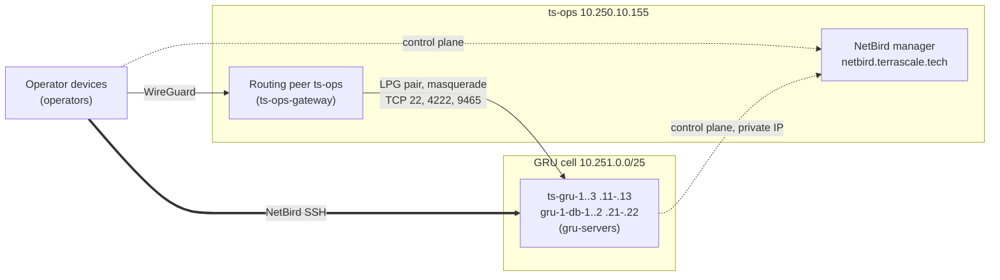

> **Legacy ts-ops runbook.** This describes the previous shared host installation,
> including unrelated Forgejo resources retained for safety. Forgejo is no longer
> a source, release, CI, or NetBird prerequisite. Do not use this layout for new
> provisioning: [REFACTOR.md](../../REFACTOR.md) specifies the dedicated GRU A1
> manager and orchestrator-owned bootstrap, Vault credentials, backup and restore.
> Those lifecycle changes remain implementation work; this migration has not
> provisioned or moved the live manager.

# NetBird

The [zero-configuration contract](../../docs/zero-configuration.md) is required production policy.
Configuration fields, manual bootstrap paths and dated observations below are
legacy implementation inventory, not feature/region activation or credential-copy
instructions. Removing runtime guards and completing automatic NetBird admission,
region inference and OCI Vault provisioning/delivery remain TS-796. Integrity,
authorization, quorum, residency and destructive-operation safeguards still apply.

Historical reset record: the GRU testing reset removed its server peers, setup keys,
group, access policies, routing network and `gru.ts.internal` zone. The manager,
ts-ops peer, operator devices and Forgejo access policies are preserved.
This records the past testing reset, not permission to rebuild a serving cell.
Existing serving cells are updated in place; see
[automatic cell admission](#automatic-cell-admission).
See
[current regional reset](../../docs/region-bootstrap.md#current-gru-reset).

Self-hosted NetBird at `https://netbird.terrascale.tech` gives enrolled
operator devices private access to ts-ops. The intended GRU topology below
adds access to the cell (private subnet
`10.251.0.0/25`) and to Forgejo on ts-ops. The manager (combined server and
dashboard) and the routing peer run on ts-ops, next to Forgejo. Every GRU
controller and managed host is also a NetBird peer, reached with NetBird SSH.



Only `10.250.10.155/32` is routed into the cell, and the cell NSGs admit it
on TCP 22, 4222 and 9465 only. Peers reach the manager over HTTPS/gRPC on 443
and STUN on UDP 3478 (Caddy on ts-ops, then `netbird-server` on
`127.0.0.1:18081`). Private servers reach it on its private IP with the public
TLS name; they need no internet route.

## Ownership

ts-orchestrator is the single home of TerraScale's NetBird. `ts-infra`
OpenTofu manages infrastructure only, and HomeLab no longer owns NetBird.

| Part | Where |
| --- | --- |
| Groups, policies, network, DNS zone and records, DNS and account settings | Desired state embedded in the `ts-orch` binary; [reconciliation](#desired-state-and-reconciliation) |
| Manager host bundle: Quadlets, systemd units, installers, backup, firewall, Caddy block | [`manager/`](manager), staged at `/opt/ts-ops/netbird` |
| Server client install and automatic enrollment | [Server enrollment](#server-enrollment), `deploy/systemd`, image inputs |
| OCI side: LPG pair, routes, cell NSG rules | [Operator gateway peering](../../docs/region-bootstrap.md#operator-gateway-peering) |
| ts-ops host (Forgejo, Caddy, ports, backups) | ts-ops host runbook |

Do not edit groups, policies, networks or settings in the dashboard. A
dashboard edit is drift: the next reconciliation reverts it.

## Desired state and reconciliation

The desired state is compiled into `ts-orch`; change it in Go, with review,
and release it like any other change.

| Command | Effect |
| --- | --- |
| `ts-orch netbird sync [--apply] [--pat-file FILE]` | Compares the manager with the desired state and prints the plan; `--apply` reconciles it |
| `ts-orch netbird prune-peers [--apply] [--offline-for DURATION]` | Plans peer hygiene for `gru-servers`: deletes disconnected peers that hold a live slot's IP or name, deletes unmatched peers offline longer than the threshold (default `24h`, minimum `1h`), and renames each slot's live peer to its slot name; `--apply` performs it |
| `ts-orch netbird remove-peers (--slot NAME... \| --all) [--apply]` | Plans deleting the disconnected `gru-servers` peers of decommissioned slots (matched by slot IP or slot peer name, e.g. `--slot ts-gru-1`), or every disconnected server peer with `--all`; connected peers are reported and kept |
| `ts-orch netbird setup-key --out FILE [--servers-group GROUP] [--apply]` | Plans the server setup key `gru-servers` (or GROUP, e.g. `sjc-servers`): reusable, never expiring, auto-assigning only that group; `--apply` creates it and writes its value only to FILE, a new `0600` file |
| `ts-orch netbird inventory` | Prints groups, policies, networks, DNS and peers as the manager reports them |
| `ts-orch netbird image-input --plan PLAN --setup-key-secret-id OCID --out FILE` | Writes another region's image `netbird.json` to the new FILE from its reviewed plan: OCI region, setup key secret and each host's node name as its peer name. Offline; no PAT |

Without `--apply` the commands only read. The legacy CLI accepts a protected
PAT file or environment input; these interfaces are TS-796 removal inventory,
not instructions to create or copy production credentials. Production
automation must discover its scoped PAT through OCI Vault. The current manager
origin override and loopback test transport are also legacy configuration gaps.
`inventory` prints allowlisted JSON and never setup-key values. Objects are
matched by name; a `renamed_from` list renames legacy objects in place, keeping
their IDs, members and setup-key auto-groups. Groups, policies, networks and
zones are never deleted; the `gru.ts.internal` zone is fully owned, so stray
records in it are removed. The server setup key is only checked, never
changed; `sync` warns when it auto-assigns any group besides `gru-servers`.
`sync` also warns about every policy outside the desired state, such as the
default `All` policy; delete those in the dashboard. `sync` refuses before any
change when the subnet differs, an
unexpected router exists, or a name is ambiguous. On a fresh account, before
the `ts-ops` peer is in `ts-ops-gateway`, it creates the groups and other
policies and defers the network, its resource and router and the policy
targeting the resource with a warning; the next sync after the routing peer
joins creates them. An existing network without its router peer is refused.

The cell's leader controller reconciles automatically when an admin PAT
secret is configured and its `netbird.json` belongs to cell `gru-1`: region
`sa-saopaulo-1` and `peer_names` equal to the desired state. Any other cell's
controller logs `NetBird manager reconciliation disabled: …` instead of
reconciling, or pruning, `gru-1`. It runs `sync --apply` and prunes replaced servers' peers
on a loop. Every controller runs the loop but only the authority lease holder
(`CanMutate`) acts: first pass about 30 s after start, then every 5 min ±20%,
backing off from 30 s to 30 min after failures. NetBird errors are logged and
never block the controller. The PAT's OCI Vault secret OCID is the optional
`admin_pat_secret_id` field of `netbird.json`; the controller reads the current
secret version every cycle, so rotating the secret needs no restart. When the
field is absent the controller logs `NetBird manager reconciliation disabled`
once and operators run the commands by hand. Only controllers may read the
secret, through a separate policy (the oci-region live check expects the
existing NetBird policy's statements verbatim):

```text
Allow dynamic-group terrascale-orchestrator to read secret-bundles in compartment id <secret_compartment_id> where target.secret.id = '<admin PAT secret OCID>'
```

Automatic provisioning must create/discover the required service credential and
least-privilege grants, deliver them through OCI Vault, and reconcile every
admitted node/region. The current optional PAT reference and pinned image inputs
are TS-796 gaps, not reconciliation enable steps. Missing credentials must hold
unauthorized mutations. Validate readback and idempotence; never remove unmanaged
objects without reviewed ownership and explicit deletion approval.

Peers join groups only through setup keys and user auto-groups;
reconciliation never sets group membership.

### Names

| Group | Members | Joined by |
| --- | --- | --- |
| `operators` | Operator devices | User auto-group, or a one-off setup key |
| `ts-ops-gateway` | ts-ops only | One-off gateway setup key |
| `gru-servers` | GRU controllers and managed hosts | Reusable server setup key |
| `<cell>-servers`: `sjc-servers`, `fra-servers` | The nodes of every catalog region other than GRU, e.g. `ts-sjc-1`..`3` | Reusable server setup key `<cell>-servers` (`setup-key --servers-group <cell>-servers`) |
| `ops-automation` | [Operator automation peers](#operator-automation-peer) | One-off setup key |

Network `gru-cell` ("TerraScale GRU private cell") holds resource
`gru-cell-private-subnet` (`10.251.0.0/25`) and one router: peer `ts-ops`,
masquerade on, metric 100. The router must be in `ts-ops-gateway`. Other
regions have no network resource: ts-ops cannot route to another region's
private subnet, so their nodes are reached with NetBird SSH only.

| Policy (= rule name) | Source → destination | Protocol, ports | Direction |
| --- | --- | --- | --- |
| `operators-to-gru-cell-ops-ports` | `operators` → resource `gru-cell-private-subnet` | TCP 22, 4222, 9465 | one-way |
| `operators-to-gru-servers-ssh` | `operators` → `gru-servers` | `netbird-ssh` | one-way |
| `ops-automation-to-gru-servers-ssh` | `ops-automation` → `gru-servers` | `netbird-ssh` | one-way |
| `operators-to-<cell>-servers-ssh` | `operators` → `<cell>-servers` | `netbird-ssh` | one-way |
| `ops-automation-to-<cell>-servers-ssh` | `ops-automation` → `<cell>-servers` | `netbird-ssh` | one-way |
| `gru-servers-to-<cell>-servers-fabric` | `gru-servers` → `<cell>-servers` | TCP 7422, 9443 | one-way |
| `<cell>-servers-to-gru-servers-fabric` | `<cell>-servers` → `gru-servers` | TCP 7422, 9443 | one-way |
| `operators-to-<cell>-servers-dashboard` | `operators`, `ops-automation` → `<cell>-servers` (also `gru-servers`) | TCP 9463, the operator dashboard on each controller's NetBird address | one-way |
| `<cell>-servers-to-<cell>-servers-ping` | Each regional servers group → itself (also `gru-servers`) | ICMP diagnostics and sibling peer DNS visibility | one-way |
| `operators-to-ts-ops-services` | `operators` → `ts-ops-gateway` | TCP 443, 2022 | one-way |
| `operators-to-ts-ops-ping` | `operators` → `ts-ops-gateway` | ICMP | one-way |

The two `-fabric` policies are the regions' fallback path beside the OCI
private peering (TS-668): the NATS interregion leafnodes (7422) and
TerraBase's peer port (9443), both directions.

Each sync reads canonical `<cell>-servers` groups from the authenticated
NetBird management API and derives their policies. The shared OCI mapping
validates region names; it does not select the participating regions. API-owned
groups remain eligible while empty or offline, so fabric access precedes NATS
readiness. JWT/integration groups and peer names do not grant server access.
Sync preserves group IDs, memberships and resources. The setup-key operation
creates a missing canonical server group before issuing its scoped auto-group
key. Region creation stores that key in Vault before reconciling fabric access
and starting nodes. GRU's peer hygiene remains limited to its own server group.

**Current gap:** TS-803 still needs to wire automatic first-controller admission,
verified regional identity and manager-secret delivery. These policy mechanics
do not prove zero-input enrollment or live cross-region NATS connectivity.

There is no default `All` policy. Do not allow 6222 or 8443 to operators. The
`netbird-ssh` policy makes the manager enable each server's NetBird SSH
server; every session still requires the operator's IdP login.

### Control Center diagram conventions

The dashboard's Control Center draws every policy; keep it readable:

- One rule per policy, rule name equal to the policy name. The 0.79 manager
  stored only a policy's first rule.
- Never use `All` as a source or destination.
- Three ports or fewer per rule.
- No bidirectional rules unless the destination must open connections back.
- Short peer names (`ts-ops`, `ts-gru-1`); they become DNS labels.
- Delete disabled or stale policies, and prune stale peers.

## DNS

| Domain | Holds | Served to |
| --- | --- | --- |
| `nb.ts.internal` | Peer names (account DNS domain), e.g. `ts-ops`, `ts-gru-1`, `mariogk-laptop` | Every peer with NetBird DNS on |
| `gru.ts.internal` | Stable cell names (custom zone, no search domain) | `operators` only |

NetBird DNS management is enabled for every group. Server enrollment uses
`--disable-dns=false`: with systemd-resolved, NetBird adds its private domains
on `wt0` while OCI's resolver remains the default on the primary interface.
The account must have no primary nameserver group; native DNS then preserves
other domains' existing resolvers. NetBird distributes names only for peers
visible through access policies. The same-region ICMP policy makes siblings'
names resolve without granting them dashboard TCP access; existing fabric
policies already make cross-region peers visible. `.local` is avoided: it is reserved for mDNS and
systemd-resolved sends it to multicast. Cell names point at fixed slot private
IPs and never change across GRU revisions or deployments.

| Name | Address and port | What it is |
| --- | --- | --- |
| `ts-gru-1.gru.ts.internal` | `10.251.0.11:22` | OpenSSH, node ts-gru-1 (controller, TerraBase member, ts-auth) |
| `ts-gru-2.gru.ts.internal` | `10.251.0.12:22` | OpenSSH, node ts-gru-2 (controller, TerraBase member, ts-auth) |
| `ts-gru-3.gru.ts.internal` | `10.251.0.13:22` | OpenSSH, node ts-gru-3 (controller, TerraBase member, ts-auth) |
| `db-1.gru.ts.internal` | `10.251.0.21:22` | OpenSSH, TerraBase member 1 |
| `db-2.gru.ts.internal` | `10.251.0.22:22` | OpenSSH, TerraBase member 2 |
| `nats.gru.ts.internal` | `10.251.0.11-13:4222` | NATS TLS on the controllers |
| `terrabase.gru.ts.internal` | `10.251.0.21-22:9465` | TerraBase HTTPS API on the members |
| `ts-gru-1.nb.ts.internal` etc. | peer NetBird IP | NetBird SSH to a GRU server |
| `ts-ops.nb.ts.internal` | `10.200.106.253:2022` | ts-ops host admin SSH |

```sh
netbird ssh root@ts-gru-1.nb.ts.internal
ssh -i ~/.ssh/terrascale-owner ubuntu@ts-gru-1.gru.ts.internal
ssh -p 2022 mariogk@ts-ops.nb.ts.internal
```

TLS on 4222 and 9465 verifies against the private IP, so clients that verify
the certificate keep using the IP; the names are for humans and SSH. TerraBase
admin endpoints (`/healthz`, `/readyz`, `/metrics`) listen on `127.0.0.1:9464`
of each member and are reached only through a NetBird SSH tunnel:

```sh
netbird ssh -L 9464:127.0.0.1:9464 root@gru-1-db-1.nb.ts.internal
curl -fsS http://127.0.0.1:9464/readyz
```

Forgejo (`git.terrascale.tech`) and the dashboard keep their public names,
because Caddy routes by Host; over NetBird, pin the name to ts-ops' NetBird IP
(`curl --resolve git.terrascale.tech:443:10.200.106.253 ...`).

### Stable peer names

Servers enroll under their [static names](../../docs/region-bootstrap.md#static-names)
the nodes `ts-gru-1`..`3` (TS-609; each runs a controller, a TerraBase member
and ts-auth) and the retired TerraBase members `gru-1-db-1`..`2`, taken from the `peer_names` map in `netbird.json`
(private IP → name), read from the primary VNIC's private IPv4 in OCI
instance metadata:

```json
"peer_names": {
  "10.251.0.11": "ts-gru-1",
  "10.251.0.12": "ts-gru-2",
  "10.251.0.13": "ts-gru-3",
  "10.251.0.21": "gru-1-db-1",
  "10.251.0.22": "gru-1-db-2"
}
```

The names are `<cell>-<slot>` (cell `gru-1`, slots `ctl-1`, `db-1`, …) from
`manager.GRU()` in
[`internal/netbird/manager/desired.go`](../../internal/netbird/manager/desired.go),
the single source. Its validation, like every `netbird.json` reader including
the image builder, rejects a name outside `internal/naming`; the image input
repeats them for enrollment, and
`TestGRUDesiredStateIsConsistentWithTheImageInput` fails when they differ.
The cell zone uses the slot names (`ctl-1.gru.ts.internal`).

A server whose address has no entry registers under its OS hostname. The name
applies at first registration; NetBird keeps a peer's name afterwards, and
`prune-peers` renames a live peer back to its static name. A new GRU revision's peer would
otherwise get a `-x-y` suffix while the replaced revision's peer still holds
the name, so replaced revisions' offline peers are pruned: automatically by
the leader controller, or with `ts-orch netbird prune-peers --apply`.

The 2026-10-02 change from `netbird.selfhosted` to `nb.ts.internal` and to
slot names renamed every peer, and the rebuilt GRU cell replaces
`gru-controller-a`/`gru-member-1` and `controller-a.gru.ts.internal` with the
static names above: update saved SSH aliases and `known_hosts`.

## Operator devices

Any device joins by logging in as an operator user; the `operators`
auto-group grants the access above:

```sh
netbird up --management-url https://netbird.terrascale.tech
```

Add dashboard users through an invite (`POST /api/users/invites`, then
`POST /api/users/invites/{token}/accept` with the password) with the
`operators` auto-group. Transfer ownership with `PUT /api/users/{id}` and
`"role": "owner"` as the current owner.

### Tailscale coexistence

NetBird is TerraScale's access network and Tailscale is the homelab's; one
device can run both. NetBird's default peer range lies inside Tailscale's
`100.64.0.0/10`, and `tailscaled` drops that source range on every interface
except `tailscale0`. The account therefore uses `10.200.0.0/16`, clear of the
homelab LANs, the Incus and Podman bridges, and both OCI VCNs. A range change
reallocates every peer address, but a connected client keeps its old address
until it reconnects (`netbird down && netbird up` keeps its identity).

Operator notebooks run the client with `DisableDNS=false` and require
`systemd-resolved`, with `/etc/resolv.conf` linked to
`/run/systemd/resolve/stub-resolv.conf`. The account has no primary
nameserver group, and one must never be added: NetBird then registers only
its own domains on `wt0` as routing domains, and every other query keeps the
device's resolver.

| Domain | Interface | DNS server |
| --- | --- | --- |
| `nb.ts.internal`, `~gru.ts.internal`, NetBird reverse zones | `wt0` | Device's NetBird address |
| `tail057f.ts.net`, `ts.net`, Tailscale reverse zones | `tailscale0` | `100.100.100.100` |
| Other domains | LAN / Wi-Fi | DHCP DNS |

`resolvectl status wt0` must show `DefaultRoute: no`. Check both VPNs:

```sh
resolvectl query alpha.tail057f.ts.net ts-ops.nb.ts.internal ctl-1.gru.ts.internal
ip route get 10.200.106.253
ssh -p 2022 mariogk@ts-ops.nb.ts.internal hostname
curl --resolve git.terrascale.tech:443:10.200.106.253 https://git.terrascale.tech/api/v1/version
```

Managed headless automation peers must enroll with scoped credentials created
and delivered through OCI Vault. Human operator devices retain their normal
identity-provider authentication and authorization; network membership never
grants operator privileges automatically.

**Current gap (TS-796):** headless client adoption and split DNS still depend on
manual setup-key and DNS activation interfaces. Those are removal inventory,
not production setup instructions. Automatic client configuration must preserve
peer identity, native split DNS, the existing default resolver and coexistence
with Tailscale. The host-network automation peer must retain its narrow internal
DNS routes and existing upstream/search domains.

Verify both network paths and name resolution before claiming readiness; the
[dashboard access check](../../docs/dashboard/README.md#check-every-controller-from-this-device)
must still succeed from each authorized device.

## Operator automation peer

Agents and COS reach the GRU servers over NetBird SSH without a browser.
NetBird SSH sessions need the user's identity-provider JWT, which the client
gets through an OAuth device flow; `ts-orch netbird ssh` answers that flow's
web forms itself. It runs `netbird ssh --no-browser`, and when the client
prints the verification URL it signs in to the manager's embedded IdP as the
regular user `ssh-automation@terrascale.tech` (role `user`, no auto-groups),
whose login it reads from Vault with the operator's `~/.oci/config`. It only
talks to `https://netbird.terrascale.tech`, refuses MFA and stops the client
when the IdP rejects the login. NetBird SSH authentication stays on for every
server; no `--disable-ssh-auth`.

The peer is a NetBird 0.79.0 client in podman container `ts-netbird-ops`
(host network, state `/var/lib/ts-netbird-ops`, interface `wt-tsops`,
WireGuard port 51821), enrolled into `ops-automation` with a one-off setup key.
That group may only open NetBird SSH to `gru-servers`, and the peer blocks
inbound connections. Legacy routing (`NB_DISABLE_CUSTOM_ROUTING`) adds no ip
rules, and NetBird DNS rewrites only the container's own `resolv.conf`, so the
host keeps its resolver and other VPNs; the host only gains the `10.200.0.0/16`
route and the `netbird` nftables tables. mariogk-dev runs peer
`mariogk-dev-ops`.

Use it:

```sh
VAULT=ocid1.vault.oc1.sa-saopaulo-1.ffvmfu2naagt6.abtxeljr7ebplea4ua3memgthsupcfn3crg6d56vipsw7o2butchdrx3urmq
NB="sudo env -u SUDO_USER -u SUDO_UID nsenter -t $(sudo podman inspect -f '{{.State.Pid}}' ts-netbird-ops) -m /usr/local/bin/netbird"
ts-orch netbird ssh --vault-id "$VAULT" --netbird "$NB" -- root@gru-1-ctl-1.nb.ts.internal hostname
ts-orch netbird ssh --vault-id "$VAULT" --netbird "$NB" -- -L 19464:127.0.0.1:9464 -L 19465:127.0.0.1:9465 root@gru-1-ctl-1.nb.ts.internal sleep 3600 &
```

The destination may name any peer, as `gru-1-ctl-1.nb.ts.internal` or
`ts-sjc-1`: the command connects to the NetBird IP that `$NB status --json`
lists for it, so names work on devices with NetBird DNS off. On 2026-10-07
delta, beta (both `sudo netbird-wt0`) and mariogk-dev-ops each opened a
session on gru-1-ctl-1..3 and ts-sjc-1..3 by name.

`NB` runs the container's NetBird CLI in the container's mount namespace
(its daemon socket and `resolv.conf`) as a direct child of `sudo`, so stopping
`ts-orch` (SIGINT or SIGTERM) also stops the session and its forwards; through
`podman exec`, which relays no signals, they would outlive it. Dropping
`SUDO_USER` keeps the CLI from looking up the invoking user in the container.
Forwards listen on the host's loopback. The daemon caches the JWT for 5
minutes (`--ssh-jwt-cache-ttl 300`; servers accept tokens up to 10 minutes
old), so later sessions skip the login. Do not pass `--no-cache`: the 0.79
client then waits on an empty device code. The command drops the
`Authentication successful!` line NetBird prints on standard output after a
fresh login, so redirected output stays intact.

After a reboot, restart the peer with `sudo deploy/netbird/operator-peer.sh`
(needs `podman` and `jq`); it keeps its identity. The script pins the image by
digest, keeps the state directory root-owned `0700`, and replaces a container
created from other arguments. The identity survives in the state directory.
Automatic adoption must create a one-off key scoped to `ops-automation`, deliver
it through OCI Vault, verify the enrolled identity and preserve existing state.
Operators must not extract a PAT, setup key or password into local files.

The existing automation-user creation uses an invite because the manager's
service-user `POST /api/users` path references a removed original creator.
**Current gap (TS-796):** automatic identity creation and credential delivery are
not yet complete. The reconciler must own the invite lifecycle and generated
password, store it directly in Vault, and verify the expected role and no
unintended auto-groups. Access revocation still requires exact peer/user
ownership and authorization; it must not grant or remove unrelated access.

## Secrets and tokens

Every NetBird secret is in the gru-1 OCI Vault; see [secrets](../../docs/secrets.md)
for names, compartments and how to read or rotate one. `install.sh` renders
`/run/terrascale-netbird/config.yaml` (root `0600`, private tmpfs) from
[`manager/templates/config.yaml.tmpl`](manager/templates/config.yaml.tmpl)
with `ts-orch vault render` and ts-ops's instance principal. The server unit
reads Vault again before each start; the container binds the runtime directory,
so no rendered configuration is kept in `/etc` on the host. Automatic
provisioning must generate the template's three keys as 32 random bytes in base64:
`gru-1-netbird-datastore-encryption-key`, `gru-1-netbird-relay-auth-secret`
and `gru-1-netbird-session-cookie-encryption-key`, in compartment `ts-ops`,
readable by the `ts-ops` dynamic group only.

| Secret | Where | Use |
| --- | --- | --- |
| Owner login `mariogk@terrascale.tech` | `gru-1-netbird-owner-email`, `gru-1-netbird-owner-password` (compartment `TerraScale`) | Dashboard only; automation never uses a human login |
| Operator automation PAT | `gru-1-netbird-automation-user-id`, `-pat`, `-pat-id`, `-pat-expires` (compartment `TerraScale`) | Operator API calls and `ts-orch netbird` by hand |
| SSH automation login `ssh-automation@terrascale.tech` | `gru-1-netbird-ssh-automation-email`, `-password` (compartment `TerraScale`) | `ts-orch netbird ssh` ([operator automation peer](#operator-automation-peer)) |
| Controller admin PAT | Service user `ts-orchestrator` (role `admin`: `network_admin` cannot rename or delete peers or change account settings). `gru-1-netbird-admin-pat`, referenced by `admin_pat_secret_id` | Leader controller reconciliation |
| Server setup key | `gru-1-netbird-setup-key`, referenced by `setup_key_secret_id` in `deploy/image/inputs/netbird-gru.json`. The historical reset invalidated the pinned `…zsrdta`; [automatic cell admission](#automatic-cell-admission) requires verified replacement delivery | Server enrollment through instance principals |

### PATs

Automation owns the `terrascale-automation` service identity and its scoped
PAT lifecycle. The current NetBird maximum lifetime is 365 days; the recorded
operator PAT was created on 2026-10-01 and expires on 2027-10-01. The reconciler
must create replacements before expiry and store the token, token ID and expiry
directly as new versions of their OCI Vault secrets. Nobody writes token files
or uploads copied credentials.

Before revoking an old PAT, verify the new `CURRENT` version by readback and
prove delivery to every consumer, including a successful `ts-orch netbird
inventory` with the replacement. If publication or delivery fails, revoke the
unused replacement and preserve the working old token. The least-privilege
owner must verify that no consumers remain before retiring `ts-infra-ci` and
its old `NETBIRD_PAT` reference; credential cleanup must preserve unrelated
Forgejo services and access.

**Current gap (TS-796):** automatic PAT creation/rotation and complete Vault
publication/delivery are not yet implemented. Legacy manual procedures are not
production setup or rotation instructions. See the
[automatic secret lifecycle](../../docs/secrets.md#automatic-secret-lifecycle).

### Setup keys

Automatic enrollment owns one-off gateway/operator keys with only their intended
auto-group. Servers use the recorded reusable, nonexpiring `gru-servers` key,
which assigns only `gru-servers`; other regions derive their own narrow server
group. No server receives a PAT. Joined peers preserve their identities when a
setup key is revoked.

The reconciler must create/discover each scoped key, store it directly in OCI
Vault, verify new-version `CURRENT` readback and deliver it to enrollment
consumers automatically. Verify an enrolled server's identity/group using the
replacement before revoking an old key. Preserve the working key if delivery
fails, and report duplicate valid key names until safe retirement completes.

**Current gap (TS-796):** explicit setup-key references and manual provisioning
interfaces remain. The testing reset deleted the legacy `gru-ts-orch-servers`
key; this is inventory, not permission to re-found a serving cell. See
[automatic cell admission](#automatic-cell-admission).

## Manager on ts-ops

| Piece | Where | Notes |
| --- | --- | --- |
| `netbird-server` | Quadlet, `netbirdio/netbird-server:0.80.0` | Management, signal, relay, STUN; `127.0.0.1:18081`, UDP `3478` |
| `netbird-dashboard` | Quadlet, `netbirdio/dashboard:v2.94.0` | `127.0.0.1:18080` |
| `netbird` network | Quadlet `netbird.network`, `10.89.77.0/24` | Keeps the dashboard's port 80 off the host |
| Caddy block | [`manager/Caddyfile.netbird`](manager/Caddyfile.netbird) | gRPC via h2c, relay/signal WebSockets, dashboard |
| Routing peer | `netbird` 0.79.0 apt package, held | `wt0` `10.200.106.253`, UDP `51820`, routes `10.251.0.0/25` with masquerade |
| Store backup | `netbird-backup.timer` 03:30 | SQLite online backup to `/var/srv/appdata/netbird/backups`, keeps 7 |

The bundle is additive to the Forgejo stack and never restarts Forgejo,
Postgres or Caddy; `uninstall.sh` returns the host to its Forgejo-only
baseline. Helper scripts install to `/usr/local/libexec/homelab/netbird`, the
path the live units use. Every NetBird unit runs at `CPUWeight=50`; memory is
capped at 384M (server), 128M (dashboard) and 192M (client).

Stage [`manager/`](manager) on ts-ops as `/opt/ts-ops/netbird`, root-owned;
the installers refuse any other directory or host.

### Install

Prerequisites: `netbird.terrascale.tech` A record → `163.176.73.79`
(DNS-only), UDP 3478 open in the Forgejo NSG, the released `ts-orch` at
`/usr/local/bin/ts-orch`, and ts-ops's read grant on its three Vault secrets
([host access](../../docs/secrets.md#host-access)).

```sh
sudo bash /opt/ts-ops/netbird/install.sh --dry-run
sudo bash /opt/ts-ops/netbird/install.sh
```

The installer renders the config from Vault, and refuses to run without
`ts-orch` or when a port is held by something else. It starts the server and dashboard on loopback,
installs the backup timer, and adds ntfy OnFailure hooks when the alerting
bundle is present.

Automatic owner provisioning must run over loopback before the public manager
name is exposed, so its unauthenticated setup page is never reachable. The
reconciler owns generated owner credentials and the temporary setup PAT, stores
owner email/password directly in the scoped OCI Vault secrets, verifies
readback/delivery, creates the least-privilege automation identity and retires
the temporary PAT only after verification. No request/response credential files
or manual Vault upload belongs in this production path.

**Current gap (TS-796):** owner provisioning and automatic delivery are not
complete; existing setup helpers are legacy interfaces. Publication must still
validate the manager/TLS configuration and owned network policy before admitting
peers. The broad default `All` policy must never grant unintended access.

### Routing peer

After [operator gateway peering](../../docs/region-bootstrap.md#operator-gateway-peering),
automatic enrollment must obtain a one-off key scoped to `ts-ops-gateway` through
OCI Vault and verify the resulting peer identity before publishing the route.
**Current gap (TS-796):** the legacy routing-peer installer still requires an
explicit key-file interface. Manual key creation/copying is retired.

The script verifies the NetBird apt key fingerprint, installs and holds
`netbird=0.79.0`, enables IPv4 forwarding, and opens UDP 51820 with
`netbird-peer-firewall.service`. DNS, client routes and its SSH server stay
off. The peer reaches its manager through the public name (OCI hairpins this
VM's public IP). Re-runs with saved client state log in without the key and
use it only if NetBird reports NeedsLogin or SessionExpired. Run
`ts-orch netbird sync --apply` again to create the deferred GRU network. The
routing peer's nftables table owns the
`netbird-acl-forward-filter` chain; never add a stock iptables FORWARD accept
ahead of it, which would bypass the access policies.

### Upgrade

Versions are pinned; nothing auto-updates. Read the release notes first:
some releases require management before clients (v0.61 SSH). Upgrade
`netbird-server` and the dashboard together by editing the Quadlet tags in
`manager/quadlets`, staging them, and taking a store snapshot:

```sh
sudo systemctl stop netbird-dashboard.service netbird-server.service
sudo cp -a /var/srv/appdata/netbird/data /var/srv/appdata/netbird/pre-upgrade-<old version>-$(date -u +%Y%m%dT%H%M%SZ)
sudo install -m 0644 /opt/ts-ops/netbird/quadlets/netbird-server.container /opt/ts-ops/netbird/quadlets/netbird-dashboard.container /etc/containers/systemd/
sudo systemctl daemon-reload
sudo systemctl start netbird-server.service netbird-dashboard.service
```

`ts-orch netbird ssh` answers the embedded IdP's device, password and
approval forms (the contract its tests pin). After an upgrade, run one
[operator automation](#operator-automation-peer) `hostname`; a changed form
makes it stop with `unexpected identity provider form` or `rejected the …`,
never post the password elsewhere.

Upgrade the routing-peer client afterwards (`apt-mark unhold netbird`,
`apt-get install netbird=<version>`, `apt-mark hold netbird`) and update
`CLIENT_VERSION` in `install-routing-peer.sh`.

On 2026-10-02 the manager moved from 0.79.0 / v2.93.0 to
`netbird-server:0.80.0` / `dashboard:v2.94.0`. The pre-upgrade snapshot is
`/var/srv/appdata/netbird/pre-upgrade-0.79.0-20261002T183529Z`. 0.80 migrates
the store on first start; the old image cannot read the migrated store.

### Rollback

Version rollback restores the snapshot together with the old tags:

```sh
sudo systemctl stop netbird-dashboard.service netbird-server.service
sudo mv /var/srv/appdata/netbird/data /var/srv/appdata/netbird/data.failed-$(date -u +%Y%m%dT%H%M%SZ)
sudo cp -a /var/srv/appdata/netbird/pre-upgrade-0.79.0-20261002T183529Z /var/srv/appdata/netbird/data
# set the Quadlet images back to netbird-server:0.79.0 and dashboard:v2.93.0
sudo systemctl daemon-reload
sudo systemctl start netbird-server.service netbird-dashboard.service
```

Changes made after the snapshot (peers, keys) are lost; `ts-orch netbird
sync` shows what reconciliation would restore.

Full removal, then remove the Caddy block and reload Caddy. Add
`--purge-data` only when the store and its backups are no longer needed:

```sh
sudo bash /opt/ts-ops/netbird/uninstall.sh
```

Uninstall also deletes the routing peer's identity (`/var/lib/netbird`), so
delete the `ts-ops` peer in the manager as well; a reinstall enrolls it with a
new setup key.

## Server enrollment

The shared GRU image installs NetBird 0.80.0 for every controller and managed
host. `deploy/image/image-inputs.json` pins the upstream ARM64 and AMD64 archive
sizes, SHA-256 checksums and extracted binary checksums. `ts-orch netbird
client` verifies the archive before streaming only its regular root-level
`netbird` executable; it does not extract archive paths or execute the
upstream installation script. `TS_NETBIRD_CLIENT_CACHE` optionally reuses
archives by digest, with verification on each use.
The running cell's signed pin and automatic updates are documented in the
[managed-client runbook](../../docs/netbird-managed.md).

The image enables `netbird.service` and `terrascale-netbird-enroll.service`.
The daemon stores its identity in root-owned `/var/lib/netbird` (0700).
Enrollment runs as root, retries failures without a systemd start-rate limit,
and invokes `terrascale-orchestrator netbird-enroll`. Neither service gates
controller or managed-host startup.

Enrollment enables NetBird split DNS, keeps server routes off and enables NetBird SSH:
root login, SFTP and local port forwarding, with identity-provider (JWT)
authentication required and remote port forwarding off. An already connected
server whose effective configuration differs is brought down once and up
again with its saved identity. Because the daemon spawns `login` and `su`
sessions, `netbird.service` runs unconfined like `ssh.service`. Sessions run
in their own logind scopes, and `KillMode=process` lets a `systemctl restart
netbird` issued from a session finish.

The public `/etc/terrascale-orchestrator/netbird.json` identifies the
management HTTPS origin, its private OCI IP, OCI region, the setup-key secret
OCID and the `peer_names` slot map. `config.example.json` shows the fields.
The production GRU input is `deploy/image/inputs/netbird-gru.json`; changes
must update its SHA-256 in the image inputs. The IP pins the management
hostname in `/etc/hosts`, preserving the HTTPS hostname and certificate
verification when private servers cannot reach the public address. The
enrollment command reads the setup key with the server's OCI instance
principal; the instance's dynamic group must have read access to that Vault
secret. Setup keys and API tokens are never image inputs.

The routing peer on ts-ops keeps its separate routing-enabled client
([Routing peer](#routing-peer)).

For an existing server, stage this repository's `deploy/netbird`,
`deploy/systemd`, `deploy/image/image-inputs.json`, and
`deploy/image/inputs/netbird-gru.json`, plus the newly built orchestrator
command and its independently verified digest. Run:

```sh
sudo ts-orch netbird install \
  --config deploy/image/inputs/netbird-gru.json \
  --enroll-binary /tmp/terrascale-orchestrator-linux-arm64 \
  --enroll-sha256 VERIFIED_ORCHESTRATOR_SHA256
```

The installer downloads and verifies the matching client, installs the new
enrollment command at `/usr/local/lib/terrascale-orchestrator/netbird-enroll`,
and points the enrollment unit there. It leaves the existing orchestrator
executable, configuration and services in place, starts NetBird and queues
enrollment asynchronously. `--client-binary FILE` accepts a predownloaded
client only when its digest and architecture match the checked-in pin.
`--root DIRECTORY` installs and enables the two services in an offline root
without starting them, to verify an additive rollout first.

On 2026-10-01 an isolated local NetBird 0.79.0 manager (embedded IdP)
verified this configuration end to end: an `operators` peer completed the IdP
device login, opened a root `netbird ssh` session in its own logind scope, and
reached a loopback-only HTTP tool through `-L`; a peer outside `operators` had
no route; after a `systemctl restart netbird` from a session the daemon
reconnected with its saved identity. Production enrollment proof is in
[`manager/enrollment-verification.json`](manager/enrollment-verification.json).
That record attests the enrollment config before `peer_names`
(`verified_enrollment_config_sha256` `ada24468…`). The shipped
`deploy/image/inputs/netbird-gru.json` (`f6124f6f…`) adds the static peer
names and is not yet covered: refresh the record after its first verified
rollout, and again after [automatic cell admission](#automatic-cell-admission)
verifies delivery of the replacement setup-key secret.

## Automatic cell admission

Private NetBird network membership admits a node automatically. The node
must discover every region, infer its own region from execution location and
start serving without a cell setup-key/feature enable step. OCI Vault must
provision and deliver first-party enrollment secrets and pick up vendor-issued
management credentials stored once.

**Current gap (TS-796):** bootstrap still requires setup-key/PAT secret references
and explicit reviewed regional inputs. The retired manual key-generation,
Vault-file upload and image-reference recipe is not automatic admission evidence.

Keep identity/role checks, least-privilege network policy, private authenticated
transport and verified artifact hashes. Automatic membership grants no operator
or customer privilege, residency exemption or destructive permission. Inspect
actual peer identity/readback before claiming enrollment; unknown/disconnected
nodes must remain visibly unavailable. Decommission still needs exact ownership
and explicit approval before peers or resources are deleted.

### Decommission

To decommission servers or a whole cell, terminate the instances, then remove
their peers; `prune-peers` keeps each down slot's last peer for its return:

```sh
ts-orch netbird remove-peers --pat-file "$PAT" --slot db-2   # or --all for the whole cell
ts-orch netbird remove-peers --pat-file "$PAT" --slot db-2 --apply
```

Revoke the setup key too when the cell is gone for good.

## Verify

Manager and routing peer, on ts-ops:

```sh
curl -fsS https://netbird.terrascale.tech/oauth2/.well-known/openid-configuration >/dev/null
curl -fsS https://netbird.terrascale.tech/api/instance   # {"setup_required":false}
sudo iptables -S FORWARD | grep netbird-stun
sudo netbird status -d
systemctl --failed
```

Configuration: `ts-orch netbird sync` (no `--apply`) reports no changes, and
`ts-orch netbird inventory` lists only current peers under slot names.

A server:

```sh
sudo systemctl status netbird terrascale-netbird-enroll
sudo netbird status --json
sudo journalctl -u terrascale-netbird-enroll --no-pager -n 30
sudo netbird debug config | grep -i ssh
```

From an operator device: TCP 4222 on the controllers, 22 and 9465 on the
members connect; 8443 and 6222 do not; `ctl-1.gru.ts.internal`
resolves to `10.251.0.11`; `netbird ssh` opens a root session on every
server.

## Troubleshooting

| Symptom | Check |
| --- | --- |
| Peer named `ts-gru-1-x-y` | A replaced revision's peer still holds the name: `ts-orch netbird prune-peers`, then `--apply` |
| Dashboard "Connection IP" is `10.89.77.1` | Forwarded-address trust (`trustedHTTPProxies`/`trustedPeers`) in the rendered config |
| NetBird dead on a dual-stack device | Peer range back in `100.64.0.0/10`; Tailscale drops it outside `tailscale0` |
| Stale address or peer map on a Linux client | `sudo systemctl restart netbird`; compare `netbird status -d` with the `wt0` address |
| `*.gru.ts.internal` does not resolve | `resolvectl status wt0` must list `~gru.ts.internal`; device in `operators`; no primary nameserver group |
| `netbird ssh` denied | Policy `operators-to-gru-servers-ssh` present, server in `gru-servers`, server clock in sync for JWT |
| Unexpected policy or group in the dashboard | Drift: `ts-orch netbird sync` shows it; `--apply` or the leader controller reverts it |
| Server never appears | `journalctl -u terrascale-netbird-enroll`; Vault read policy for the instance's dynamic group; egress to `10.250.10.155` TCP 443 and UDP 3478 |

A STUN binding request to `163.176.73.79:3478` must return the client's
public address.
