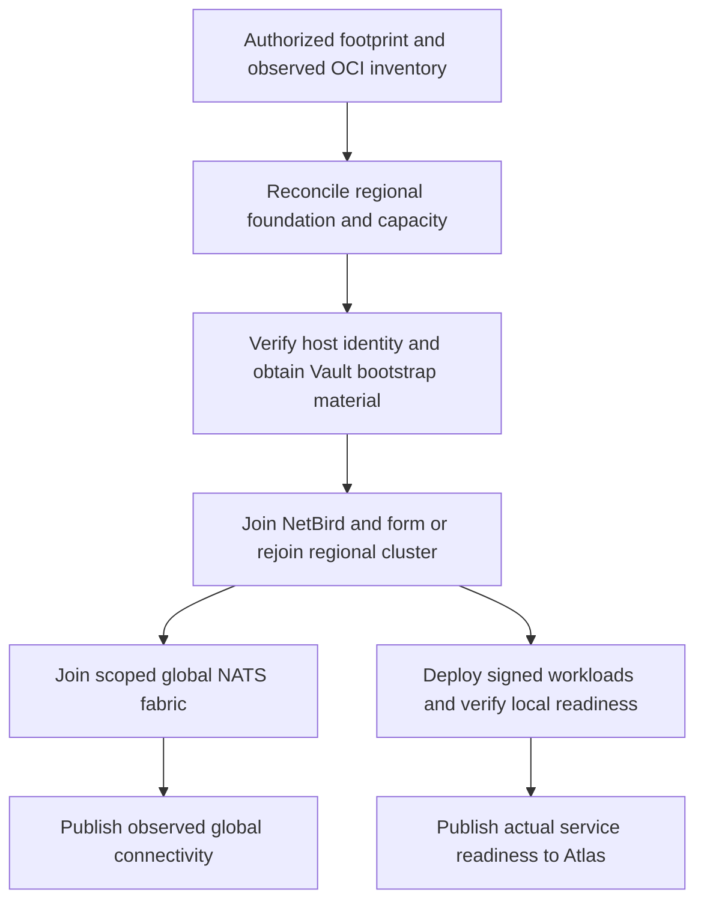

# Automatic regional lifecycle

Desired state, 2026-10-16. `ts-orch` automatically deploys each authorized region,
forms its regional cluster and joins the global cluster. This document defines
the implementation contract; it does not claim the lifecycle is wired today.

## Start automatically within the authorized footprint

Once the tenancy foundation and spend/ownership scope are authorized, continuous
reconciliation deploys and repairs GRU (`sa-saopaulo-1`), San Jose
(`us-sanjose-1`, existing product token `sjc`) and FRA (`eu-frankfurt-1`).
There is no per-region activation flag or operator-run setup sequence.
OCI subscription status, a region catalog entry or an unverified NetBird peer
alone is not authority to provision capacity. Additional regions and spending
retain their approval boundaries; this is the authorization scope, not a second
region-enable mechanism.

Global-link unavailability must not stop an established region from serving
locally. Work that requires unavailable global authority remains explicitly
pending; it must not invent a replacement authority.

## One continuous owner for every stage

| Stage | Automatic work | Completion evidence |
| --- | --- | --- |
| Foundation | Derive names/addresses from authoritative inventory, reconcile owned OCI resources, scoped credentials, qualified architecture-specific capacity and bootstrap routing. Recover ongoing work with retry tokens/ETags where supported. | Recorded owned resource IDs and observed completed OCI operations; no duplicate resources after retries. |
| Network admission | Recover or bootstrap the dedicated GRU NetBird server, verify OCI host identity, deliver scoped enrollment material through Vault, reconcile peer/group/policy/DNS membership. | Expected private identity and required endpoint connectivity; no pasted tokens or maintained peer maps. |
| Regional formation | Reserve founder authority durably, form regional embedded NATS/JetStream, join scheduler managers/workers through their distinct roles and recover persisted node identity. | One regional cluster identity, observed membership/quorum as appropriate to the qualified topology, role-correct authenticated admission. |
| Global admission | Reconcile versioned loop-free leaf topology and scoped credentials/imports/exports at both affected ends. Generate interregion controller material and mesh policy automatically. | Intended parent/child identities, authenticated regional request/reply, observable topology generation and connection health. |
| Serving and repair | Discover signed artifacts, provision first-party service credentials, reconcile placement and ingress, verify readiness, publish actual Atlas service health and continue repairing drift. | Real serving evidence and CLI/dashboard visibility; failures distinguish network, cluster, global-link and workload stages. |

## Avoid bootstrap cycles and competing founders

The existing serving-region roster describes admitted membership/health. It
cannot be the sole input for discovering a region that has not yet booted.
Use authorized OCI inventory plus trusted foundation records reachable before
NetBird and public discovery exist. The GRU NetBird foundation must not depend
on the overlay or scheduler it is bootstrapping.

Persist provisioning intent, admitted membership and observed readiness as
separate lifecycle facts, using existing durable control/operation stores.
Claim the regional founding operation with an atomic conditional write and
authority generation; resume that operation on takeover. Recheck generation
before mutations and reject stale founders. Regional NATS and scheduler
formation each retain their own identity, recovery and role-admission rules.
Do not create a new quorum solely because discovery or an old founder timed out.
First inspect existing identities, data and in-flight creates; quorum recovery
requires its established safety rules.

Network admission automatically starts role-scoped regional admission after
verified identity checks. A function worker cannot become a manager or obtain
deployment-admin credentials. Normal restart reuses persisted identity; host
replacement retires old membership only after the required fencing/drain checks.

## A global federation of regional clusters

Each region owns its NATS/JetStream and scheduler consensus. The global cluster
is the existing authenticated interregion fabric and global control/membership
contract. Do not turn regional Raft groups into a single WAN quorum or add a
second global scheduler. Keep existing global control authority semantics.

Derive links and credential scopes from admitted membership. Reconcile both
sides of a topology change, validating the proposed tree and preparing matching
peer material before connecting. Reconcile version/generation mismatch rather
than falling back to wildcard subject access or cyclic leaf links. Unavailable
peers make affected joins pending; do not disrupt existing healthy routes.
Initial topology is rooted in GRU. Its failure can interrupt cross-region
communication and new global joins while established local workloads continue.

Expose provisioning, overlay admission, regional readiness, global connectivity
and workload readiness separately through the shared CLI/API and dashboard.
Joining is automatic; being present in a peer list is not serving-health proof.
Publish only verified ready service endpoints. Retain admitted regions in the
membership inventory through outages, with explicit unhealthy/unreachable state.

## Current source gaps

`internal/region/create.go` contains a resumable operator-driven create sequence,
with a local journal, explicit attempt/home-plan inputs and shell-out command
adapters. `internal/region/cli.go` still exposes these prerequisites. This is
reusable behavior, not continuous region reconciliation or distributed founder
fencing. Do not run it concurrently from every host or merely wrap it in a loop.

`internal/atlas` and its publisher still require configured topology inputs;
existing signed publication alone does not establish automatic region admission.
`internal/natscell/interregion.go` validates explicit signed peer/topology and
account material; generating and reconciling both ends automatically remains
work. Preserve its scope and tree validation. NetBird/Vault bootstrap gaps are
tracked in [REFACTOR.md](../REFACTOR.md) and [Atlas](atlas.md).

Reuse the existing feature packages and one operation/membership authority.
Replace manual inputs in the target path; do not add activation flags, alternate
provisioners or a second source of regional truth.

## Acceptance evidence

1. From the authorized three-region footprint, show automatic deployment,
   regional formation, global joining and serving without per-region CLI calls,
   edited peer lists, copied credentials or activation steps.
2. Boot several controllers/workers concurrently and interrupt the founding
   authority during provisioning. Resume with no duplicate foundations, active
   stale founder, competing regional identity or role escalation.
3. Restart/reboot and replace hosts. Rejoin the intended regional/global
   memberships, preserving cluster/data identity and workload fencing.
4. Interrupt Vault, discovery, NetBird coordination and the GRU NATS hub
   separately. Report blocked stages, keep healthy local serving, and recover
   automatically when dependencies return without re-founding existing clusters.
5. Prove six directed regional request/replies and a real signed rollout,
   record stage timings/resource usage and show corresponding CLI/dashboard
   state. Publish redacted evidence under `benchmark/bench/`.

No infrastructure, IAM, credentials or paid resources are changed by this plan.
